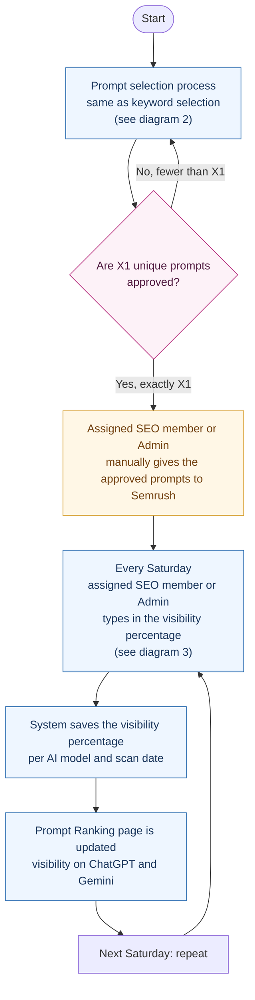
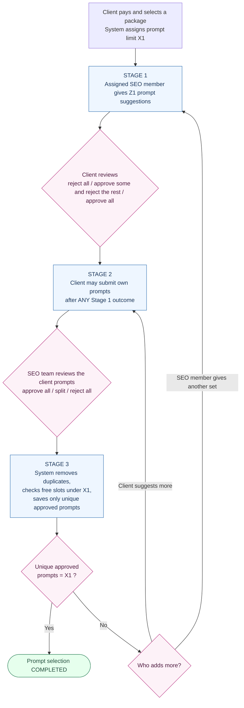
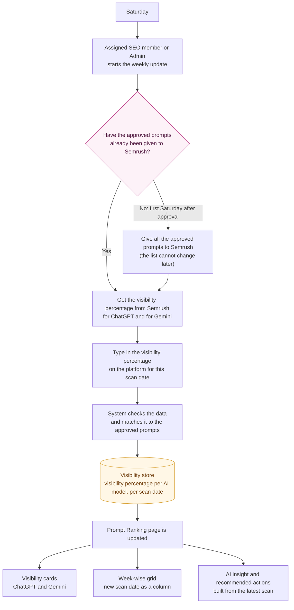

# Prompt Ranking Flow

**Notation:** X1 = prompt limit of the client's package. Z1 = number of prompt suggestions the SEO team gives in one batch. A **scan date** = the week the data belongs to. **Visibility** = how often the brand appears in an AI model's answers to the client's prompts, shown for **ChatGPT** and **Gemini**.

**Roles:** the **Client**, the **Assigned SEO team member**, the **Admin**, and the **System**.

**Goal:** once the client's X1 prompts are approved, the **assigned SEO team member or the Admin** manually gives the prompts to **Semrush**, then **types in** the **visibility percentage** on the platform every Saturday, with no missed week, so the client sees their visibility on ChatGPT and Gemini on the Prompt Ranking page.

This flow has two parts: how prompts are selected (the same process as keyword selection) and how the data reaches the page. For comparison, see [keywords ranking flow.md](keywords%20ranking%20flow.md), where the team also updates ranking data manually, but every Monday and by ranks per keyword. For the selection process itself, see [keyword selections.md](keyword%20selections.md).

## In short

1. **Select:** the client approves exactly X1 prompts, the same way as keywords. Approved prompts cannot be changed.
2. **Give to Semrush:** the assigned SEO team member or the Admin manually gives the approved prompts to Semrush, once.
3. **Update every Saturday:** the assigned SEO team member or the Admin types in the visibility percentage on the platform. The Saturday update is never missed.
4. **See:** the client sees their visibility on ChatGPT and Gemini on the Prompt Ranking page. The client cannot add or change any data.

## 1. Overall journey

Plain reading:

- Prompts are selected the same way as keywords. Nothing goes to Semrush until exactly X1 prompts are approved.
- The assigned SEO member or the Admin **manually gives the approved prompts to Semrush**.
- Every Saturday the assigned SEO member or the Admin **types in the visibility percentage** (for ChatGPT and Gemini) on the platform. The client cannot do this. The Saturday update is always done: there is no way of missing it.
- **Once prompts are approved, they cannot be changed.** The approved list stays fixed, so the same prompts are tracked every week.
- The client then sees the **visibility on ChatGPT and Gemini** on the Prompt Ranking page.

## 2. Prompt selection (same as keyword selection)

Prompt selection follows the same three stages as keyword selection. Only the words change.

| In keyword selection | In prompt selection |
|---|---|
| Keywords | **Prompts** |
| Keyword limit X | **Prompt limit X1** |
| Z keyword suggestions | **Z1 prompt suggestions** |
| Approved Keywords | **Approved Prompts** |
| Rejected Keywords | **Rejected Prompts** |

The rules are the same as for keywords:

- Every rejection needs **one common remark**. Rejected prompts are stored in Rejected Prompts and do not count.
- Approved prompts are stored against the **Client ID and Subscription ID**, as unique prompts only.
- **No one can approve more than X1 prompts**, including when approving all at once.
- Nothing is visible to the client until the **payment** is complete.
- The process ends only when exactly **X1** unique prompts are approved.
- **Once a prompt is approved it cannot be changed.**

For the full detail of each case, see [keyword selections.md](keyword%20selections.md).

## 3. Every Saturday: updating the data

What is the same and different compared with the keyword ranking flow:

| | Keyword ranking | Prompt ranking |
|---|---|---|
| What is shown | Rank of each keyword | **Visibility on ChatGPT and Gemini**, and the prompt grid |
| Update method | Manual: by hand or by CSV | **Typed in by hand** |
| Extra step | None | Prompts are manually given to **Semrush** first |
| Weekly day | Monday | **Saturday** |
| Who does it | Assigned SEO member or Admin | Assigned SEO member or Admin |
| Client can add data | No | No |

## System rules

- Prompts are given to Semrush only after **X1** prompts are approved.
- The prompts used are the **approved prompts** of the client's Client ID and Subscription ID. Rejected prompts are never given to Semrush.
- The **assigned SEO team member or the Admin** manually gives the prompts to Semrush and **types in** the visibility percentage. The client cannot.
- **Approved prompts cannot be changed.** They are given to Semrush once, and the same prompts are used every week.
- The data is updated **every Saturday**, and the Saturday update is never missed.
- What is entered each Saturday is the **visibility percentage**, for each AI model (ChatGPT and Gemini).
- The visibility percentage is stored **per AI model and per scan date**. The Prompt Ranking page also shows a grid with a value for **each prompt on each scan date** (see "Checked in the live app").
- The page shows the visibility on **ChatGPT and Gemini**.
- If no visibility percentage is entered for a model, the page shows `0.00%` for it.
- After the data is saved, the Prompt Ranking page is updated for the client.

## Roles and Scope

| Role | What they can do | What they cannot do |
|------|------------------|---------------------|
| **Client** | Approve prompts (prompt selection). View the Prompt Ranking page: visibility on ChatGPT and Gemini. | Cannot give prompts to Semrush. Cannot add or change the data. |
| **Assigned SEO team member** | Give prompt suggestions, review the client's prompts, manually give the approved prompts to Semrush, and type in the visibility percentage every Saturday | Cannot approve more than X1 prompts. |
| **Admin** | Same as the assigned SEO member for any client | – |
| **System** | Check X1, save approved prompts, check and save the updated data, update the page | – |
| **Semrush** | Holds the prompts given by the team and provides their results | – |

## Data and Storage

| Data | Stored where | Notes |
|------|--------------|-------|
| Approved Prompts | Prompt selection storage (`prompts_brandwise` in the page docs) | At most X1, unique, per Client ID + Subscription ID. Locked once approved |
| Rejected Prompts | Prompt selection storage | With the common remark, no limit |
| Prompts and results at the source | Semrush | Given and read by the team |
| Visibility percentage | Platform store (`weekly_prompt_ranking` and `monthly_percentage` are named in the page docs) | Per AI model (ChatGPT, Gemini), per scan date |
| Insight and actions | Not stored | Generated again on every page load |

## Checked in the live app

The Prompt Ranking page was opened for one brand (Pro User view) and its calls were recorded. This confirms these points:

| Finding | What it shows |
|---------|---------------|
| Scan dates are **Saturdays**, seven days apart (for example 14-Nov-2026, 07-Nov-2026, 31-Oct-2026, back to 23-May-2026) | Confirms the Saturday update. The very first date seen, 18-May-2026, is a Monday. |
| The page shows **ChatGPT** and **Gemini** because both are switched on for the brand (`brand_model_config`: ChatGPT on, Gemini on, Perplexity off, AI Overview off) | The models shown depend on the brand's setup. |
| `get_prompt_selection_access` returns `max_prompts` (X1, **75** for this brand), `is_paid`, `questionnaire_completed`, `has_proposal_rows`, `has_ranking_rows`, `eligible` and `prompts_finalized` | The same access state as keyword selection: the prompt limit, the payment rule, and whether prompt selection is completed. |
| The tracked prompt list comes from `prompts_brandwise` (22 prompts for this brand) | The approved prompts are what the page tracks. |
| `fetch-prompt-visibility` returns **every prompt** with a `type` (for example non-branded) and a value for **each scan date**: a rank number such as 1 to 5, or empty | The page shows a grid with a value for each prompt on each scan date, besides the percentage per model. |
| `fetch-prompt-weekly-summary` returns a "Ranked Prompts" count per date, for ChatGPT and for Gemini | The ranked-prompt count is worked out from the per-prompt values. |
| The cards show "Visibility %" for Gemini and for ChatGPT | The percentage shown on the cards. |
| **Semrush is not mentioned anywhere** in the page or in its calls | Giving prompts to Semrush and getting results back happens **outside** the client-facing platform. Admin screens were not visible to this account, so they were not checked. |

## Runbook: Every Saturday

1. Confirm the client has **X1 approved prompts**. If not, go back to prompt selection.
2. On the first Saturday after approval, give all the approved prompts to Semrush. After that this step is already done, because approved prompts do not change.
3. Get the visibility percentage for ChatGPT and for Gemini from Semrush.
4. Type in the visibility percentage on the platform for this Saturday's scan date.
5. Open **Analytics → Prompt Ranking** for the client's brand.
6. Check that the new scan date shows as a column in the grid and that the ChatGPT and Gemini visibility cards updated.

## Troubleshooting

| Situation | What to check |
|-----------|---------------|
| Nothing to give to Semrush | The client may not have approved X1 prompts yet. Finish prompt selection. |
| The visibility percentage looks wrong | Check the values entered for that scan date against Semrush for each AI model, and correct them. |
| The new Saturday data is missing | It should not happen, because the Saturday update is always done. Reload the page. If it is still missing, report it. |
| Someone asks to change an approved prompt | Not allowed. Approved prompts cannot be changed. |
| Gemini or ChatGPT shows `0.00%` visibility | No visibility percentage was entered for that model this week, or the value is really 0. |
| The client cannot add data | By design. Only the assigned SEO member or the Admin can. |

## Open points

Everything above is final. These two points were not in the source description and could not be seen in the live app. Confirm them with the product team:

| # | Question |
|---|----------|
| 1 | How are the prompts given to Semrush: typed in, imported as a file, or another way? The live page does not show this. |
| 2 | The live page holds a rank per prompt per date and a visibility percentage per model. Does the team type both, or only the percentage? Which one feeds the other? |
