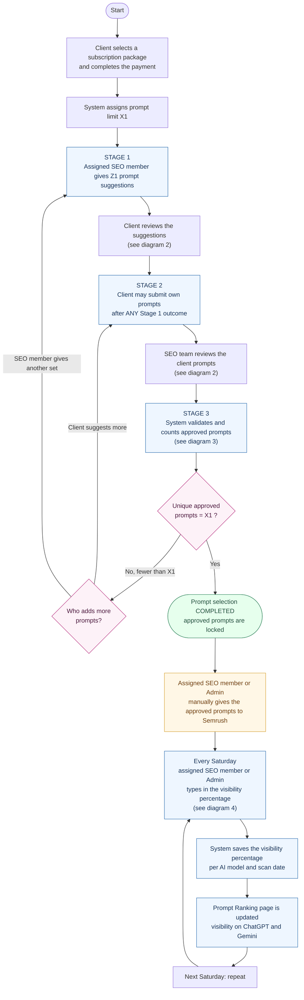
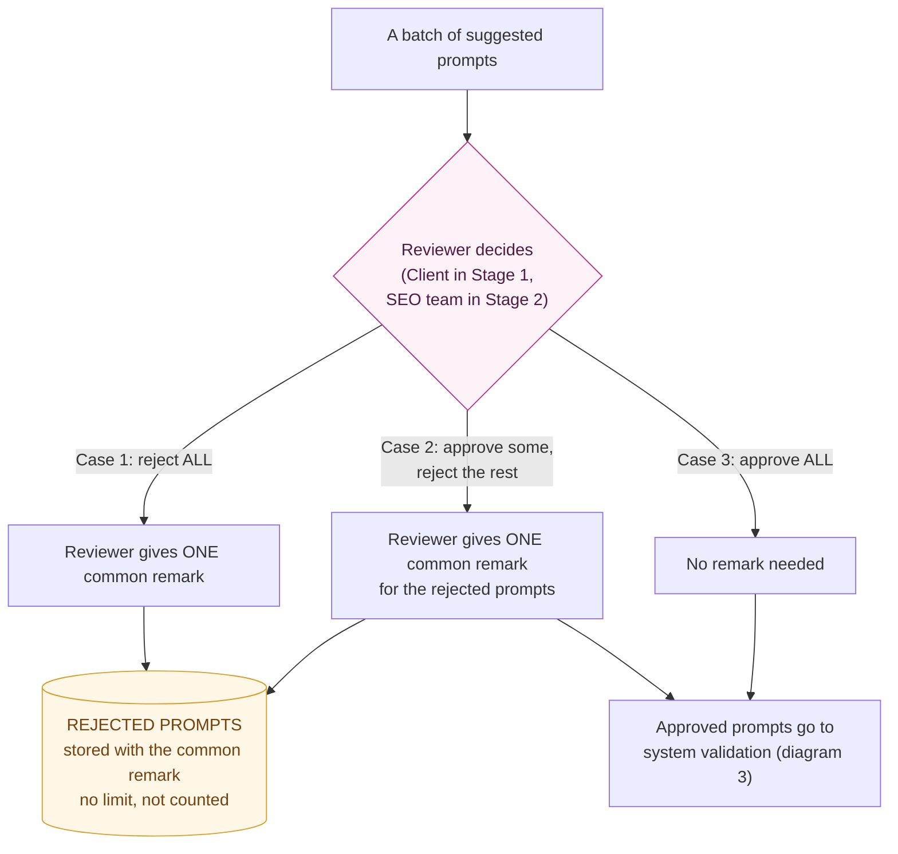
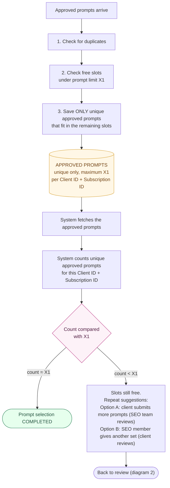
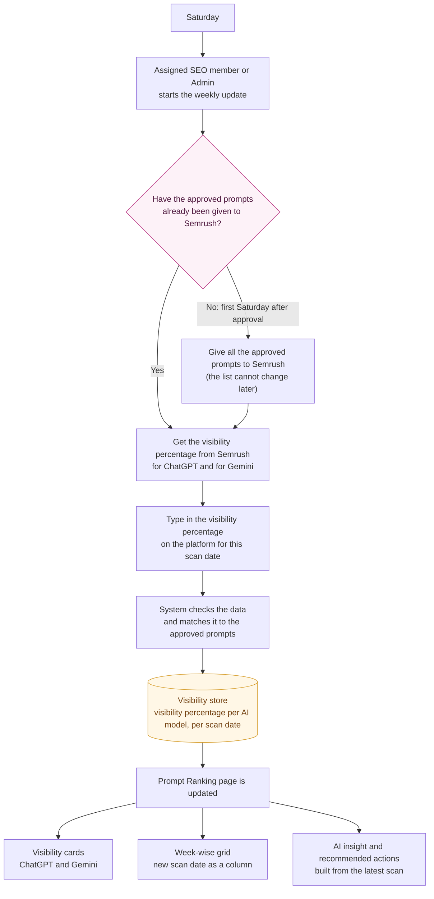

# Prompt Ranking Flow

**Notation:** X1 = prompt limit of the client's subscription package. Z1 = number of prompt suggestions the SEO team gives in one batch. A **scan date** = the week the data belongs to. **Visibility** = how often the brand appears in an AI model's answers to the client's prompts, shown for **ChatGPT** and **Gemini**.

**Roles:** the **Client**, the **Assigned SEO team member** (the SEO team member assigned to the client), the **Admin**, and the **System**.

**Goal:** the client approves exactly X1 unique prompts. The assigned SEO team member or the Admin then manually gives the approved prompts to **Semrush** and, every Saturday, types in the **visibility percentage** on the platform. The client sees their visibility on ChatGPT and Gemini on the Prompt Ranking page.

The flow is shown in four diagrams: the overall journey, how a batch of prompts is reviewed, how the system validates and counts approved prompts, and the weekly Saturday update.

## Purpose and Access

Prompt ranking shows the client how their brand appears when AI models (ChatGPT and Gemini) answer the client's own prompts. First the prompts are selected, then they are tracked every week.

**Payment comes first.** Nothing in this process is visible to the client on the platform until the client has **completed the payment** for the subscription package:

- Before payment: the client sees no prompt suggestions, no Approved Prompts or Rejected Prompts sections, no option to submit prompts, and no Prompt Ranking data.
- After payment: the prompt limit X1 is assigned from the paid package, and the client can see and work on the prompt selection screens.
- The SEO team's suggestions are shown to the client only after payment is complete.

## In short

1. **Select:** the client approves exactly X1 unique prompts. Approved prompts cannot be changed.
2. **Give to Semrush:** the assigned SEO team member or the Admin manually gives the approved prompts to Semrush, once.
3. **Update every Saturday:** the assigned SEO team member or the Admin types in the visibility percentage on the platform. The Saturday update is never missed.
4. **See:** the client sees their visibility on ChatGPT and Gemini on the Prompt Ranking page. The client cannot add or change any data.

## 1. Overall journey

Plain reading:

- **Stages 1 to 3** decide which X1 prompts are approved. They repeat until exactly X1 unique prompts are approved.
- **Then** the approved prompts are locked and given to Semrush.
- **Every Saturday** the visibility percentage is typed in and the page is updated.

## 2. How a batch of prompts is reviewed (Stage 1 and Stage 2)

The same three outcomes apply in both stages. Only the reviewer changes.

| Stage | Prompts come from | Reviewer |
|---|---|---|
| Stage 1 | Assigned SEO team member (Z1 suggestions) | **Client** |
| Stage 2 | Client (own prompts, allowed after any Stage 1 outcome) | **SEO team** |

| Case | What the reviewer does | Where the prompts go |
|---|---|---|
| **1. Reject all** | Rejects every prompt and gives one common remark explaining why | All to **Rejected Prompts** with the remark |
| **2. Approve some, reject the rest** | Approves some, rejects the others, and gives one common remark for the rejected ones | Approved to validation, then **Approved Prompts**. Rejected to **Rejected Prompts** with the remark |
| **3. Approve all** | Approves every prompt. No remark needed | All to validation, then **Approved Prompts** |

Case 1 ends with nothing approved, so the approved count stays the same.

## 3. Validation and count check (Stage 3)

This runs every time prompts are approved.

## Approval limit (X1)

- **No one can approve more than X1 prompts.** This applies to every way of approving: one by one, in bulk, and approving **all** at once.
- The limit applies to the **total** of approved prompts, not to one batch. The number that can still be approved is **X1 minus the prompts already approved**.
- If Z1 is bigger than the remaining slots, not all prompts can be approved. Approve only as many as the remaining slots allow and reject the rest with the common remark.
- The same limit applies when the SEO team approves the client's own prompts in Stage 2.
- The system checks again at save time (diagram 3). It saves only unique approved prompts that fit in the remaining slots.
- Example: X1 = 20, 15 already approved, 10 new prompts suggested. Only 5 more can be approved. The other 5 are rejected and go to Rejected Prompts with the common remark.

## 4. Every Saturday: updating the data

## Prompt storage

| Storage section | Data stored | Storage limit |
|---|---|---|
| Approved Prompts | Unique approved prompts. **Locked once approved.** | Maximum X1 prompts |
| Rejected Prompts | Rejected prompts with their common rejection remark | No limit |

## System rules

**Selection**

- Nothing is visible to the client until the **payment** is complete.
- Approved prompts are stored against the respective **Client ID** and **Subscription ID**.
- Duplicate prompts are never counted twice.
- Every rejection needs **one common remark**. Rejected prompts are stored separately with their remarks and do not count towards the approved total.
- The system checks the available slots before saving approved prompts.
- **No one can approve more than X1 prompts**, including when approving all at once.
- The client can submit their own prompts after the initial SEO suggestions, whether they approved or rejected the initial ones.
- The assigned SEO team member keeps providing suggestions whenever required.
- The selection ends only when exactly **X1** unique prompts are approved.
- **Once a prompt is approved it cannot be changed.**

**Semrush and weekly update**

- Prompts are given to Semrush only after **X1** prompts are approved. Rejected prompts are never given to Semrush.
- The **assigned SEO team member or the Admin** manually gives the prompts to Semrush and **types in** the visibility percentage. The client cannot.
- The prompts are given to Semrush once, and the same prompts are used every week.
- The data is updated **every Saturday**, and the Saturday update is never missed.
- The visibility percentage is stored **per AI model and per scan date**, for **ChatGPT and Gemini**. The Prompt Ranking page also shows a grid with a value for **each prompt on each scan date** (see "Checked in the live app").
- If no visibility percentage is entered for a model, the page shows `0.00%` for it.
- After the data is saved, the Prompt Ranking page is updated for the client.

## Roles and Scope

| Role | What they can do | What they cannot do |
|------|------------------|---------------------|
| **Client** | After payment: view and review the SEO team's prompt suggestions (approve, or reject with one common remark), submit their own prompts, view Approved and Rejected Prompts, and view the Prompt Ranking page | Cannot see anything before payment. Cannot approve more than X1 prompts. Cannot reject without a remark. Cannot change an approved prompt. Cannot give prompts to Semrush. Cannot add or change the visibility data. |
| **Assigned SEO team member** | Give prompt suggestions (Z1 per batch), review the client's own prompts, give another set whenever required, manually give the approved prompts to Semrush, and type in the visibility percentage every Saturday | Cannot approve more than X1 prompts. Cannot reject without a remark. Cannot change an approved prompt. Cannot make anything visible to the client before payment. |
| **Admin** | Same as the assigned SEO team member for any client | Same limits as the assigned SEO team member |
| **System** | Assign X1 from the package, validate duplicates and free slots, save approved and rejected prompts, count unique approved prompts, mark the selection Completed, check and save the weekly data, update the page | – |
| **Semrush** | Holds the prompts given by the team and provides their results | – |

## Status of a Prompt

Status is set by the review decision. It is not typed in.

| Status | Meaning | Stored in | Counts towards X1? |
|--------|---------|-----------|---------------------|
| **Suggested (pending review)** | Given by the SEO member or submitted by the client and waiting for review | – | No |
| **Approved** | Approved, unique and within the free slots. Locked. | Approved Prompts | Yes |
| **Rejected** | Rejected with the reviewer's common remark | Rejected Prompts | No |

The **selection** has two states: **In progress** (fewer than X1 unique approved prompts) and **Completed** (exactly X1 unique approved prompts).

## Data and Storage

| Data | Stored where | Notes |
|------|--------------|-------|
| Prompt limit X1 | From the paid package | Assigned after payment |
| Approved Prompts | Prompt storage (`prompts_brandwise` in the page docs) | At most X1, unique, per Client ID + Subscription ID. Locked once approved |
| Rejected Prompts | Prompt storage | With the common remark, no limit |
| Prompts and results at the source | Semrush | Given and read by the team |
| Visibility percentage | Platform store (`weekly_prompt_ranking` and `monthly_percentage` are named in the page docs) | Per AI model (ChatGPT, Gemini), per scan date |
| Insight and actions | Not stored | Generated again on every page load |

Permissions are checked by the platform for every read and write, in line with the roles above.

## Checked in the live app

The Prompt Ranking page was opened for one brand (Pro User view) and its calls were recorded. This confirms these points:

| Finding | What it shows |
|---------|---------------|
| Scan dates are **Saturdays**, seven days apart (for example 14-Nov-2026, 07-Nov-2026, 31-Oct-2026, back to 23-May-2026) | Confirms the Saturday update. The very first date seen, 18-May-2026, is a Monday. |
| The page shows **ChatGPT** and **Gemini** because both are switched on for the brand (`brand_model_config`: ChatGPT on, Gemini on, Perplexity off, AI Overview off) | The models shown depend on the brand's setup. |
| `get_prompt_selection_access` returns `max_prompts` (X1, **75** for this brand), `is_paid`, `questionnaire_completed`, `has_proposal_rows`, `has_ranking_rows`, `eligible` and `prompts_finalized` | The prompt limit, the payment rule, and whether prompt selection is completed. |
| The tracked prompt list comes from `prompts_brandwise` (22 prompts for this brand) | The approved prompts are what the page tracks. |
| `fetch-prompt-visibility` returns **every prompt** with a `type` (for example non-branded) and a value for **each scan date**: a rank number such as 1 to 5, or empty | The page shows a grid with a value for each prompt on each scan date, besides the percentage per model. |
| `fetch-prompt-weekly-summary` returns a "Ranked Prompts" count per date, for ChatGPT and for Gemini | The ranked-prompt count is worked out from the per-prompt values. |
| The cards show "Visibility %" for Gemini and for ChatGPT | The percentage shown on the cards. |
| **Semrush is not mentioned anywhere** in the page or in its calls | Giving prompts to Semrush and getting results back happens **outside** the client-facing platform. Admin screens were not visible to this account, so they were not checked. |

## Runbook: Client

1. Complete the payment for the subscription package. The prompt selection screens become visible only after this.
2. Wait for the assigned SEO member's prompt suggestions (Z1 prompts).
3. Review each suggested prompt. You can:
   - **Reject all:** give one common remark explaining why.
   - **Approve some and reject the rest:** give one common remark for the rejected prompts.
   - **Approve all:** no remark is needed, but you cannot approve more than the remaining slots (X1 minus already approved).
4. Optionally submit your **own** prompts. You can do this after any outcome above, even after rejecting all.
5. The SEO team reviews your prompts. Check Approved Prompts and Rejected Prompts to see the result and any remark.
6. If the approved count is still below X1, you can submit more prompts, or the SEO member gives another set. Repeat until X1 unique prompts are approved.
7. When exactly X1 unique prompts are approved, the selection is **Completed** and the prompts are locked.
8. From then on, open **Analytics → Prompt Ranking** to see your visibility on ChatGPT and Gemini. It updates every Saturday.

## Runbook: Assigned SEO Team Member

1. After the client's payment, give the first batch of Z1 prompt suggestions.
2. When the client submits their own prompts, review them: approve all, approve some and reject the rest (one common remark), or reject all (one common remark).
3. Do not approve more prompts than the remaining slots (X1 minus already approved).
4. If the approved count is below X1 and the client has no more prompts to submit, give another set of suggestions. Keep doing this whenever required.
5. Stop only when the system marks the selection **Completed** (X1 unique approved prompts).
6. Manually give the approved prompts to Semrush, once.
7. Every Saturday, follow the Saturday runbook below.

## Runbook: Every Saturday (assigned SEO team member or Admin)

1. Confirm the client has **X1 approved prompts**. If not, go back to prompt selection.
2. On the first Saturday after approval, give all the approved prompts to Semrush. After that this step is already done, because approved prompts do not change.
3. Get the visibility percentage for ChatGPT and for Gemini from Semrush.
4. Type in the visibility percentage on the platform for this Saturday's scan date.
5. Open **Analytics → Prompt Ranking** for the client's brand.
6. Check that the new scan date shows as a column in the grid and that the ChatGPT and Gemini visibility cards updated.

## Troubleshooting

| Situation | What to check |
|-----------|---------------|
| Client cannot see any prompts or sections | Check that the payment is completed. Nothing is shown before payment. |
| Client cannot approve all suggested prompts | The remaining slots are fewer than the suggested prompts. Approve only as many as fit and reject the rest with the common remark. |
| Rejection cannot be submitted | A common remark is required for every rejection. Add it and submit again. |
| An approved prompt was not saved | It was a duplicate of an approved prompt, or there were no free slots left. Duplicates are not counted twice. |
| Approved count is below X1 | Ask the client for more prompts, or give another set of suggestions. |
| Selection is not Completed | The unique approved count is not exactly X1 yet. |
| Someone asks to change an approved prompt | Not allowed. Approved prompts cannot be changed. |
| Nothing to give to Semrush | The client may not have approved X1 prompts yet. Finish prompt selection. |
| The visibility percentage looks wrong | Check the values entered for that scan date against Semrush for each AI model, and correct them. |
| The new Saturday data is missing | It should not happen, because the Saturday update is always done. Reload the page. If it is still missing, report it. |
| Gemini or ChatGPT shows `0.00%` visibility | No visibility percentage was entered for that model this week, or the value is really 0. |
| The client cannot add data | By design. Only the assigned SEO team member or the Admin can. |

## Open points

Everything above is final. These points were not in the source description and could not be seen in the live app. Confirm them with the product team:

| # | Question |
|---|----------|
| 1 | How are the prompts given to Semrush: typed in, imported as a file, or another way? The live page does not show this. |
| 2 | The live page holds a rank per prompt per date and a visibility percentage per model. Does the team type both, or only the percentage? Which one feeds the other? |
| 3 | The exact on-screen wording of messages, and the exact point where the platform blocks an approval beyond X1, are not specified. |
