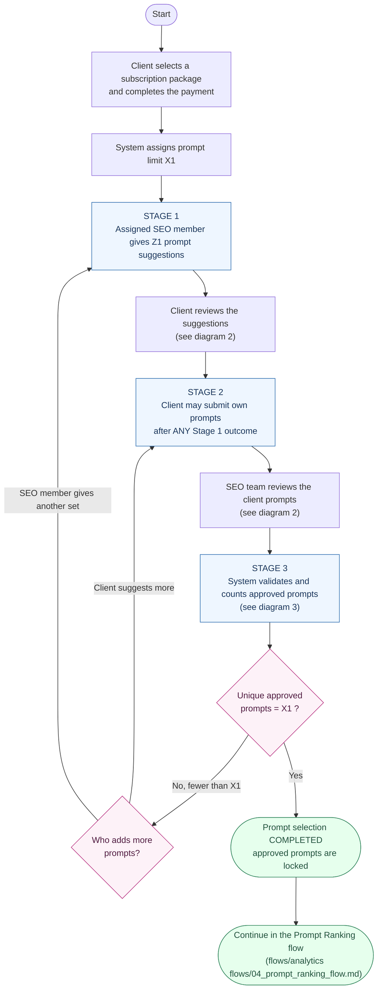
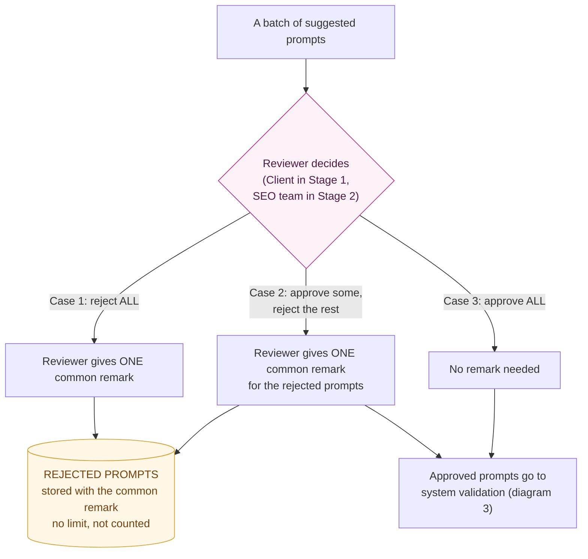
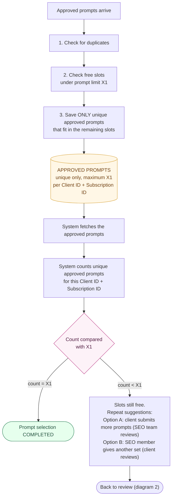

# Prompt Selection Flow

**Notation:** X1 = prompt limit of the client's subscription package. Z1 = number of prompt suggestions the SEO team gives in one batch.

**Roles:** the **Client**, the **Assigned SEO team member** (the SEO team member assigned to the client), the **Admin**, and the **System**.

**Goal:** the client approves exactly X1 unique prompts. Once X1 prompts are approved, the selection is **Completed**, the prompts are locked, and they move on to the **Prompt Ranking flow** (see `flows/analytics flows/04_prompt_ranking_flow.md`).

The flow is shown in three diagrams: the overall journey, how a batch of prompts is reviewed, and how the system validates and counts approved prompts.

## Purpose and Access

Prompt selection decides which prompts the platform tracks for the client. The prompts come from the SEO team and from the client, and the client approves exactly X1 of them.

**Payment comes first.** Nothing in this process is visible to the client on the platform until the client has **completed the payment** for the subscription package:

- Before payment: the client sees no prompt suggestions, no Approved Prompts or Rejected Prompts sections, and no option to submit prompts.
- After payment: the prompt limit X1 is assigned from the paid package, and the client can see and work on the prompt selection screens.
- The SEO team's suggestions are shown to the client only after payment is complete.

## In short

1. The client pays, and the system assigns X1.
2. The assigned SEO team member gives Z1 suggestions. The client approves or rejects them.
3. The client may submit their own prompts at any time after Stage 1. The SEO team reviews them.
4. The system checks duplicates and free slots, and saves only unique approved prompts.
5. This repeats until exactly X1 unique prompts are approved. Approved prompts cannot be changed.
6. The selection is Completed. The approved prompts then go to the Prompt Ranking flow.

## 1. Overall journey

Plain reading:

- **Stages 1 to 3** decide which X1 prompts are approved. They repeat until exactly X1 unique prompts are approved.
- When the count reaches X1, the approved prompts are locked and the selection ends.

## 2. How a batch of prompts is reviewed (Stage 1 and Stage 2)

The same three outcomes apply in both stages. Only the reviewer changes.

| Stage | Prompts come from | Reviewer |
|---|---|---|
| Stage 1 | Assigned SEO team member (Z1 suggestions) | **Client** |
| Stage 2 | Client (own prompts, allowed after any Stage 1 outcome) | **SEO team** |

| Case | What the reviewer does | Where the prompts go |
|---|---|---|
| **1. Reject all** | Rejects every prompt and gives one common remark explaining why | All to **Rejected Prompts** with the remark |
| **2. Approve some, reject the rest** | Approves some, rejects the others, and gives one common remark for the rejected ones | Approved to validation, then **Approved Prompts**. Rejected to **Rejected Prompts** with the remark |
| **3. Approve all** | Approves every prompt. No remark needed | All to validation, then **Approved Prompts** |

Case 1 ends with nothing approved, so the approved count stays the same.

## 3. Validation and count check (Stage 3)

This runs every time prompts are approved.

## Approval limit (X1)

- **No one can approve more than X1 prompts.** This applies to every way of approving: one by one, in bulk, and approving **all** at once.
- The limit applies to the **total** of approved prompts, not to one batch. The number that can still be approved is **X1 minus the prompts already approved**.
- If Z1 is bigger than the remaining slots, not all prompts can be approved. Approve only as many as the remaining slots allow and reject the rest with the common remark.
- The same limit applies when the SEO team approves the client's own prompts in Stage 2.
- The system checks again at save time (diagram 3). It saves only unique approved prompts that fit in the remaining slots.
- Example: X1 = 20, 15 already approved, 10 new prompts suggested. Only 5 more can be approved. The other 5 are rejected and go to Rejected Prompts with the common remark.

## Prompt storage

| Storage section | Data stored | Storage limit |
|---|---|---|
| Approved Prompts | Unique approved prompts. **Locked once approved.** | Maximum X1 prompts |
| Rejected Prompts | Rejected prompts with their common rejection remark | No limit |

## System rules

- Nothing is visible to the client until the **payment** is complete.
- Approved prompts are stored against the respective **Client ID** and **Subscription ID**.
- Duplicate prompts are never counted twice.
- Every rejection needs **one common remark**. Rejected prompts are stored separately with their remarks and do not count towards the approved total.
- The system checks the available slots before saving approved prompts.
- **No one can approve more than X1 prompts**, including when approving all at once.
- The client can submit their own prompts after the initial SEO suggestions, whether they approved or rejected the initial ones.
- The assigned SEO team member keeps providing suggestions whenever required.
- The selection ends only when exactly **X1** unique prompts are approved.
- **Once a prompt is approved it cannot be changed.**
- Rejected prompts are never passed on to the ranking flow.

## Roles and Scope

| Role | What they can do | What they cannot do |
|------|------------------|---------------------|
| **Client** | After payment: view and review the SEO team's prompt suggestions (approve, or reject with one common remark), submit their own prompts, and view Approved and Rejected Prompts | Cannot see anything before payment. Cannot approve more than X1 prompts. Cannot reject without a remark. Cannot change an approved prompt. |
| **Assigned SEO team member** | Give prompt suggestions (Z1 per batch), review the client's own prompts, and give another set whenever required | Cannot approve more than X1 prompts. Cannot reject without a remark. Cannot change an approved prompt. Cannot make anything visible to the client before payment. |
| **Admin** | Same as the assigned SEO team member for any client | Same limits as the assigned SEO team member |
| **System** | Assign X1 from the package, validate duplicates and free slots, save approved and rejected prompts, count unique approved prompts, mark the selection Completed | – |

## Status of a Prompt

Status is set by the review decision. It is not typed in.

| Status | Meaning | Stored in | Counts towards X1? |
|--------|---------|-----------|---------------------|
| **Suggested (pending review)** | Given by the SEO member or submitted by the client and waiting for review | – | No |
| **Approved** | Approved, unique and within the free slots. Locked. | Approved Prompts | Yes |
| **Rejected** | Rejected with the reviewer's common remark | Rejected Prompts | No |

The **selection** has two states: **In progress** (fewer than X1 unique approved prompts) and **Completed** (exactly X1 unique approved prompts).

## Data and Storage

| Data | Stored where | Notes |
|------|--------------|-------|
| Prompt limit X1 | From the paid package | Assigned after payment |
| Approved Prompts | Prompt storage (`prompts_brandwise` in the page docs) | At most X1, unique, per Client ID + Subscription ID. Locked once approved |
| Rejected Prompts | Prompt storage | With the common remark, no limit |

Permissions are checked by the platform for every read and write, in line with the roles above.

## Runbook: Client

1. Complete the payment for the subscription package. The prompt selection screens become visible only after this.
2. Wait for the assigned SEO member's prompt suggestions (Z1 prompts).
3. Review each suggested prompt. You can:
   - **Reject all:** give one common remark explaining why.
   - **Approve some and reject the rest:** give one common remark for the rejected prompts.
   - **Approve all:** no remark is needed, but you cannot approve more than the remaining slots (X1 minus already approved).
4. Optionally submit your **own** prompts. You can do this after any outcome above, even after rejecting all.
5. The SEO team reviews your prompts. Check Approved Prompts and Rejected Prompts to see the result and any remark.
6. If the approved count is still below X1, you can submit more prompts, or the SEO member gives another set. Repeat until X1 unique prompts are approved.
7. When exactly X1 unique prompts are approved, the selection is **Completed** and the prompts are locked.
8. Rankings for the approved prompts then appear on the Prompt Ranking page (see `flows/analytics flows/04_prompt_ranking_flow.md`).

## Runbook: Assigned SEO Team Member (and Admin)

1. After the client's payment, give the first batch of Z1 prompt suggestions.
2. When the client submits their own prompts, review them: approve all, approve some and reject the rest (one common remark), or reject all (one common remark).
3. Do not approve more prompts than the remaining slots (X1 minus already approved).
4. If the approved count is below X1 and the client has no more prompts to submit, give another set of suggestions. Keep doing this whenever required.
5. Stop only when the system marks the selection **Completed** (X1 unique approved prompts).
6. Continue with the Prompt Ranking flow: give the approved prompts to Semrush (see `flows/analytics flows/04_prompt_ranking_flow.md`).

## Troubleshooting

| Situation | What to check |
|-----------|---------------|
| Client cannot see any prompts or sections | Check that the payment is completed. Nothing is shown before payment. |
| Client cannot approve all suggested prompts | The remaining slots are fewer than the suggested prompts. Approve only as many as fit and reject the rest with the common remark. |
| Rejection cannot be submitted | A common remark is required for every rejection. Add it and submit again. |
| An approved prompt was not saved | It was a duplicate of an approved prompt, or there were no free slots left. Duplicates are not counted twice. |
| Approved count is below X1 | Ask the client for more prompts, or give another set of suggestions. |
| Selection is not Completed | The unique approved count is not exactly X1 yet. |
| Someone asks to change an approved prompt | Not allowed. Approved prompts cannot be changed. |

## Open points

Confirm these with the product team:

| # | Question |
|---|----------|
| 1 | The exact on-screen wording of messages, and the exact point where the platform blocks an approval beyond X1, are not specified. |
