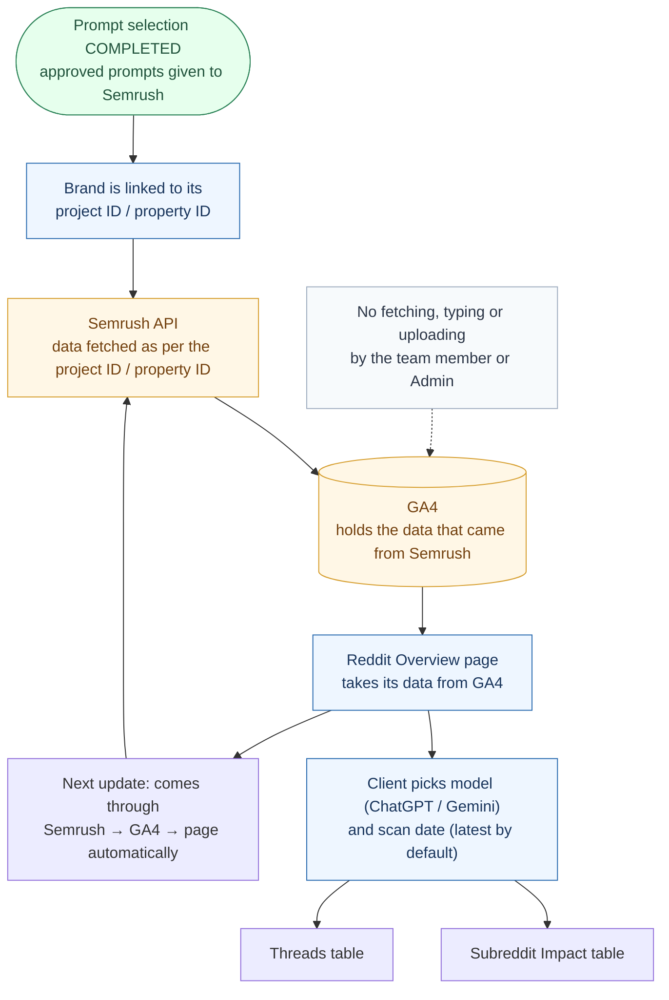

# Reddit Overview Flow

**Notation:** A **subreddit** = a Reddit community. A **thread** = one Reddit post. A **scan date** = the date a set of results belongs to. The **project ID / property ID** = the ID that links the brand to its project in Semrush and in GA4.

**Roles:** the **Client**, the **Assigned SEO team member**, the **Admin**, the **System**, **Semrush** and **GA4**.

**Starting point:** the approved prompts from `prompt selections.md`, tracked in Semrush (see `prompt ranking flow.md`).

**Goal:** the page shows which subreddits and threads AI models cite when answering the brand's prompts. The page data is taken from **GA4**. GA4 gets its data from **Semrush**, using the **project ID / property ID** through the **Semrush API**. Nobody types in or uploads the data, and it keeps updating automatically.

## Purpose and Access

The page (`/analytics/reddit-overview`) has a model dropdown (ChatGPT or Gemini) and a scan-date dropdown, and two tables:

1. **Subreddit Impact:** prompts, visibility %, threads and citations per subreddit.
2. **Threads:** the cited threads, with their link, subreddit and number of prompts.

There is no AI insight line and no recommended actions on this page. The client can only view it.

## In short

1. The brand is linked to its Semrush project ID / property ID (once).
2. The data comes from Semrush into GA4 through the Semrush API.
3. The page takes its data from GA4.
4. The page updates automatically. The client chooses the model and scan date.

## 1. Overall journey

## System rules

- The page data is taken from **GA4**.
- GA4 gets the data from **Semrush**, matched by the brand's **project ID / property ID**, through the **Semrush API**.
- The same source is used for the Citation Overview, the Sentiment Overview and the Product Leaderboard.
- The data updates **automatically**. There is no manual add or upload.
- The client cannot add or change any data.
- The data is **brand scoped**.
- The model and the scan date drive **both tables**. Available dates differ per model.
- **Visibility %** = the subreddit's share of all subreddit citations for that scan.
- A scan date with no subreddit data shows "No subreddit data available yet." in Subreddit Impact. The Threads table can still list rows for that date.

## Roles and Scope

| Role | What they can do | What they cannot do |
|------|------------------|---------------------|
| **Client** | View the page, change the model and scan date | Cannot add or change data |
| **Assigned SEO team member** | Make sure the brand is linked to the correct project ID / property ID | Does not fetch, type in or upload data |
| **Admin** | Same as the assigned SEO team member for any client | Same limits |
| **System** | Show the data from GA4 on the page | – |
| **Semrush** | Source of the data, read through the Semrush API by project ID / property ID | – |
| **GA4** | Holds the data that came from Semrush and feeds the page | – |

## Data and Storage

| Data | Stored where | Notes |
|------|--------------|-------|
| Brand ↔ project ID / property ID | Brand setup | Set once per brand |
| Source data | Semrush, read through the Semrush API | Matched by project ID / property ID |
| Page data | GA4 | Comes from Semrush |
| Both tables and the date list | `fetch-reddit-overview` (per the page docs) | `{}` for ChatGPT and the latest date; model and date added when chosen |

Page details: `doc analytics/08-reddit-overview.md`.

## Runbook: Client

1. Finish prompt selection (see `prompt selections.md`).
2. Open **Analytics → Reddit Overview**.
3. Choose a model and a scan date to see the subreddits and threads.

## Runbook: Assigned SEO Team Member (and Admin)

1. Make sure the prompts are given to Semrush and the brand has the correct project ID / property ID.
2. That is all. **Do not fetch or type in any data.**

## Troubleshooting

| Situation | What to check |
|-----------|---------------|
| "No subreddit data available yet." | No subreddit data for that model and date. Try another date. If every date is empty, check the project ID / property ID. |
| Gemini has fewer dates | Available dates differ per model. |
| Someone wants to upload data | Not needed and not done. |

## Open points

| # | Question |
|---|----------|
| 1 | How often does the data update? |
| 2 | What happens if the Semrush API call fails? Who is told? |
