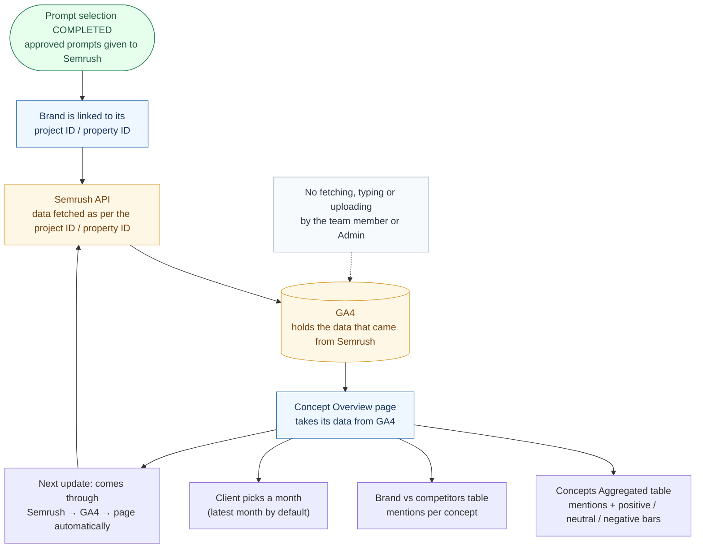

# Sentiment Overview Flow

> Written for the **Concept Overview** page (`/analytics/concept-overview`, `doc analytics/07-concept-overview.md`), because it is the only analytics page that shows sentiment. If "Sentiment Overview" means a different page, tell me and I will change it.

**Notation:** A **concept** = a topic AI models associate with the brand (for example manufacturing, certifications, ingredients). **Sentiment** = positive, neutral or negative. The **project ID / property ID** = the ID that links the brand to its project in Semrush and in GA4.

**Roles:** the **Client**, the **Assigned SEO team member**, the **Admin**, the **System**, **Semrush** and **GA4**.

**Starting point:** the approved prompts from `prompt selections.md`, tracked in Semrush (see `prompt ranking flow.md`).

**Goal:** the page shows which concepts AI models associate with the brand, how often, and with what sentiment. The page data is taken from **GA4**. GA4 gets its data from **Semrush**, using the **project ID / property ID** through the **Semrush API**. Nobody types in or uploads the data, and it keeps updating automatically.

## Purpose and Access

The page shows:

1. **Concepts Aggregated** for a chosen month: each concept, its mentions, and the positive / neutral / negative counts with bars.
2. A second table comparing how often each concept is mentioned for the brand versus its competitors.

The client can only view the page. The client cannot add or change any data.

## In short

1. The brand is linked to its Semrush project ID / property ID (once).
2. The data comes from Semrush into GA4 through the Semrush API.
3. The page takes its data from GA4.
4. The page updates automatically. The client picks a month to see.

## 1. Overall journey

## System rules

- The page data is taken from **GA4**.
- GA4 gets the data from **Semrush**, matched by the brand's **project ID / property ID**, through the **Semrush API**.
- The same source is used for the Citation Overview, the Reddit Overview and the Product Leaderboard.
- The data updates **automatically**. There is no manual add or upload.
- The client cannot add or change any data.
- The data is **brand scoped**.
- The month list comes from the data. The latest month is shown first.
- Zero values are shown as `0`. In the sampled brands and months, every negative value was 0.

## Roles and Scope

| Role | What they can do | What they cannot do |
|------|------------------|---------------------|
| **Client** | View the page and change the month | Cannot add or change data |
| **Assigned SEO team member** | Make sure the brand is linked to the correct project ID / property ID | Does not fetch, type in or upload data |
| **Admin** | Same as the assigned SEO team member for any client | Same limits |
| **System** | Show the data from GA4 on the page | – |
| **Semrush** | Source of the data, read through the Semrush API by project ID / property ID | – |
| **GA4** | Holds the data that came from Semrush and feeds the page | – |

## Data and Storage

| Data | Stored where | Notes |
|------|--------------|-------|
| Brand ↔ project ID / property ID | Brand setup | Set once per brand |
| Source data | Semrush, read through the Semrush API | Matched by project ID / property ID |
| Page data | GA4 | Comes from Semrush |
| Concepts, mentions, sentiments, month list | `fetch-concept-data` (per the page docs) | `{}` for the latest month, `{ "month": "{YYYY-MM}" }` for another month |

## Runbook: Client

1. Finish prompt selection (see `prompt selections.md`).
2. Open **Analytics → Concept Overview**.
3. Pick a month to see the concepts and their sentiment.

## Runbook: Assigned SEO Team Member (and Admin)

1. Make sure the prompts are given to Semrush and the brand has the correct project ID / property ID.
2. That is all. **Do not fetch or type in any data.**

## Troubleshooting

| Situation | What to check |
|-----------|---------------|
| No concepts show | Check the project ID / property ID and that the prompts were given to Semrush. Then report it to the product team. |
| Negative column is empty | Every negative value is 0 for that month. This is a real result. |
| Someone wants to upload data | Not needed and not done. |

## Open points

| # | Question |
|---|----------|
| 1 | Is "Sentiment Overview" the Concept Overview page, or a separate page? |
| 2 | How often does the data update (the page is monthly)? |
| 3 | What happens if the Semrush API call fails? Who is told? |
