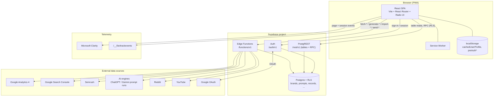
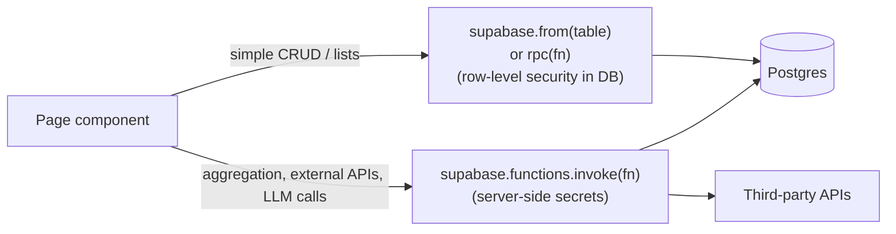
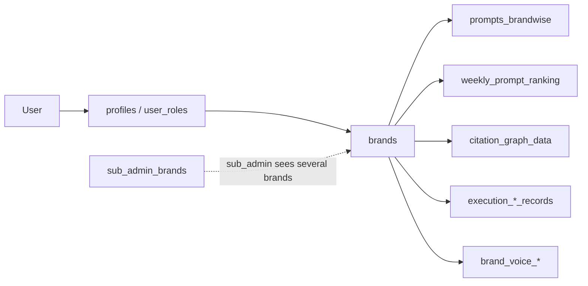

# 01 · System Architecture

How the DareAISearch platform (`app.dareaisearch.com`) is put together, as observed from the live app and its JS bundle.

## Facts observed

| Layer | What it is | Evidence |
|---|---|---|
| Frontend | React SPA built with Vite, React Router, Radix UI components, installed as a PWA (service worker, `apple-mobile-web-app-*` tags). Originally generated with **Lovable** (`meta author`). | `index.html`, `/assets/index-*.js`, `registerSW.js` |
| Backend | **Supabase**: Auth, PostgREST (`/rest/v1`), RPC functions, and Edge Functions (`/functions/v1`). | all XHR go to one `*.supabase.co` project |
| Auth | Supabase email/password plus "Continue with Google". Google is also connected separately for GA4 and Search Console data. | `/auth/v1/token`, `google-oauth-url`, `google_connections` |
| Analytics sources | GA4, Google Search Console, Semrush, AI-engine prompt tracking (ChatGPT, Gemini), Reddit, YouTube. | edge functions listed in doc 07 |
| Telemetry | Microsoft Clarity, a first-party `/__l5e/trackevents` endpoint, and in-house `user_sessions` / `user_page_sessions` tables. | network log |
| Client cache | `localStorage`: `cachedUserProfile`, `preAuthBrandName`, `preAuthName`, `preAuthWebsiteUrl`, `sidebar-opened-before`. | bundle |

## Component diagram

## Request pattern

Two access paths exist, and which one a page uses tells you where its logic lives:

- **Execution pages** (Image Alt, Schema Markup, Reddit, and so on) read straight from `execution_*_records` tables.
- **Analytics pages** call edge functions (`fetch-*`), which aggregate GA4, GSC, Semrush and prompt-run data.
- **AI insight panels** ("RECOMMENDED ACTIONS") call `generate-page-insights` with `{page, brand, source, signals}`.

## Brand scoping (multi-tenant)

Almost every request is scoped by **brand**. Normal users see one brand (here *Herbal Chakra*). Internal staff can override it, which is why edge functions take `brandOverride`. Brand access is enforced by RLS plus helper RPCs such as `current_user_brand_name`, `get_prompt_selection_access` and `get_keyword_selection_access`.

