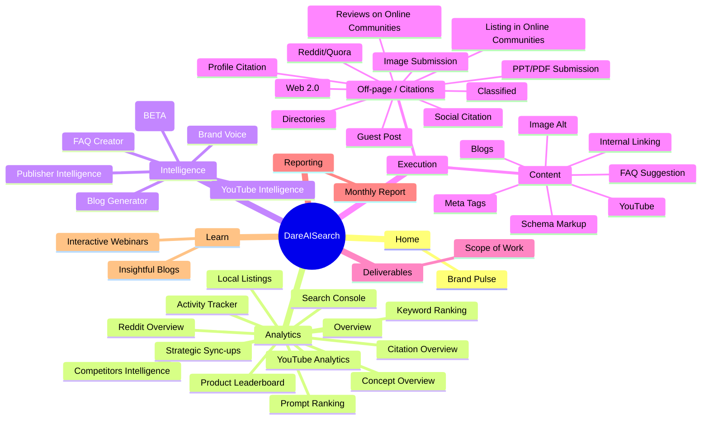
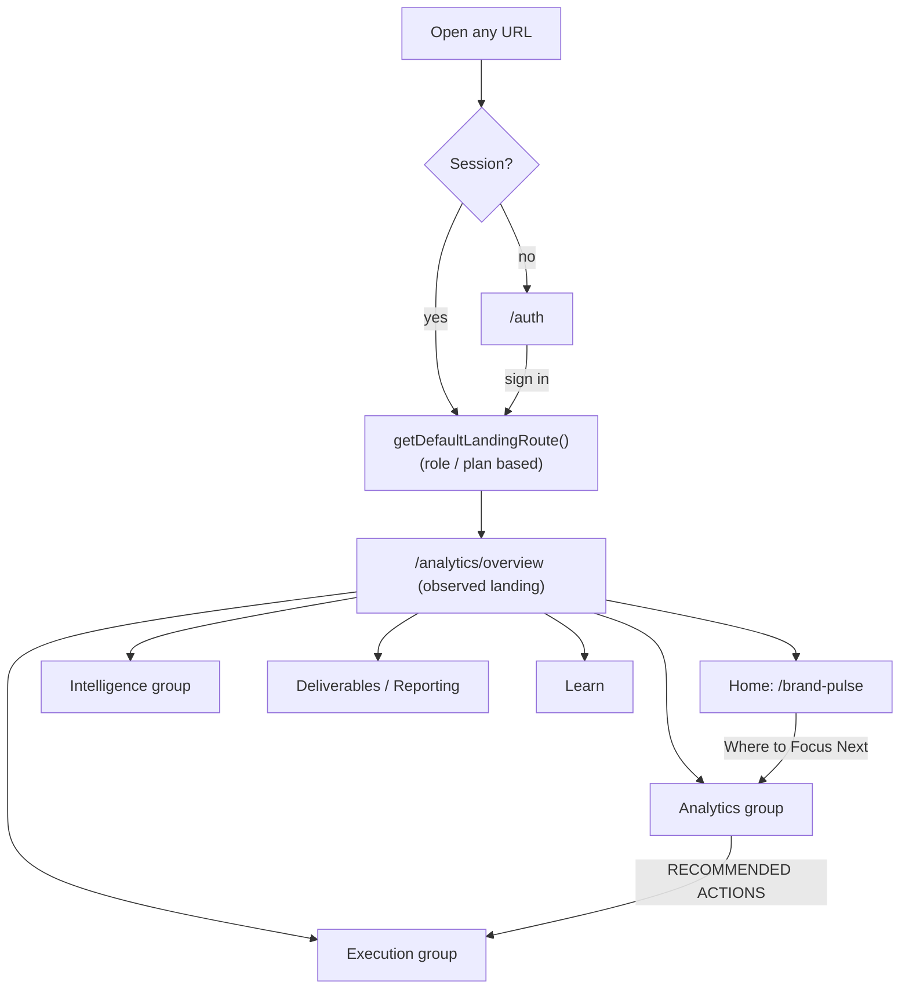

# 02 · Sitemap & Navigation

## Sidebar as seen by the logged-in Pro user

Header bar: brand switcher (Herbal Chakra), light/dark toggle, notifications bell, avatar. Footer: plan badges (*Pro User*, *DAIS Growth*), **Sign out**. A floating sparkle button opens the AI chat (`analytics-chat`).

## Full route table (from the JS router)

Routes marked **hidden** exist in the router but were not in this user's sidebar. They are probably role-gated or legacy. This is an inference, not confirmed.

| Group | Routes |
|---|---|
| Public / auth | `/`, `/auth`, `/reset-password`, `*` (404) |
| Onboarding & billing | `/questionnaire`, `/growth/questionnaire`, `/growth/plan`, `/growth/checkout`, `/growth/thank-you`, `/subscription`, `/subscription/checkout`, `/subscription/success`, `/trial-dashboard` |
| Home | `/dashboard`, `/brand-pulse` |
| Analytics (visible) | `/analytics/overview`, `console-insights`, `competitors`, `prompt-ranking`, `keyword-ranking`, `citations`, `concepts`, `reddit-overview`, `youtube`, `product-leaderboard`, `local-listings`, `activity`, `brand-mom`, `prompt-research` |
| Analytics (**hidden**) | `/analytics/citation-overview`, `/analytics/citation-leaderboard`, `/analytics/overall-performance` |
| Intelligence (visible) | `/intelligence/brand-voice`, `/blog-generator-v2`, `/faq-generator`, `/youtube-intelligence`, `/intelligence` (Publisher) |
| Intelligence (**hidden**) | `/blog-generator` (v1), `/prompt-generator`, `/intelligence/competitor-research`, `/intelligence/dais-crawler`, `/intelligence/dais-crawler-v2`, `/intelligence/dais-crawler/report/:jobId`, `/intelligence/recommendations`, `/intelligence/visibility-overview`, `/hdie`, `/hdie/backfill`, `/hdie/intelligence` |
| Execution (visible) | 17 pages, see doc 05 |
| Execution (**hidden**) | `/execution/broken-links`, `/execution/heading-tags`, `/execution/robots-txt`, `/execution/sitemap`, `/execution/meta-tags-new` |
| Deliverables / reporting | `/deliverables`, `/deliverables/scope-of-work`, `/scope-of-work`, `/reporting/monthly` |
| Learn | `/insightful-blogs`, `/interactive-webinars` |
| Notifications | `/notifications` |
| **Admin (hidden)** | `/admin/users`, `/admin/brand-delivery`, `/admin/task-manager`, `/admin/internal-mom`, `/admin/notifications`, `/admin/knowledge-base`, `/admin/citation-intelligence`, `/admin/data-check`, `/admin/backfill-tracker`, `/admin/semrush-integration`, `/admin/user-flow`, `/admin/youtube-overview` |

## Navigation flow

