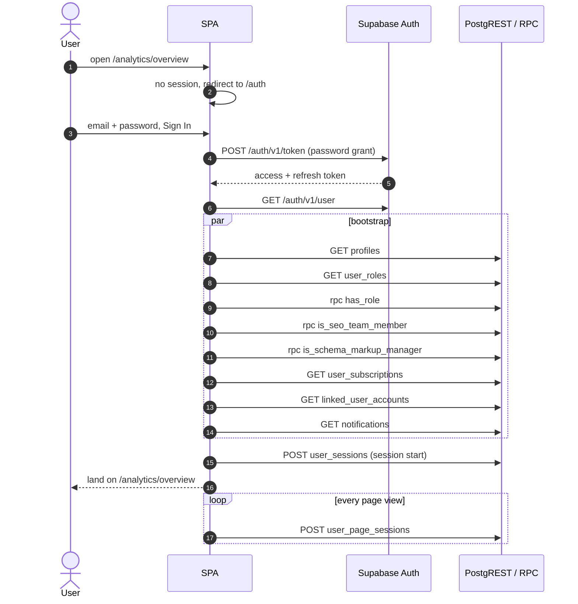
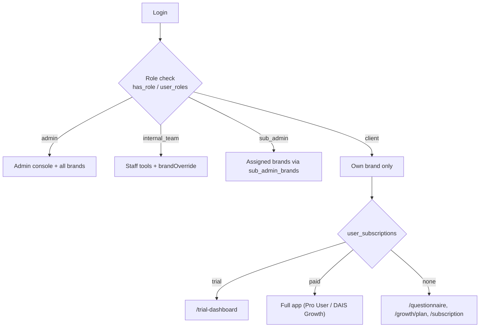
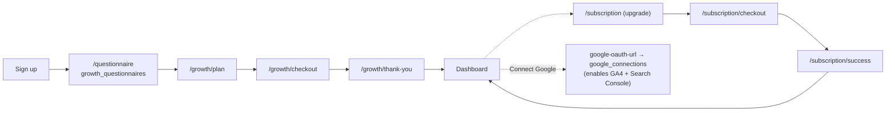
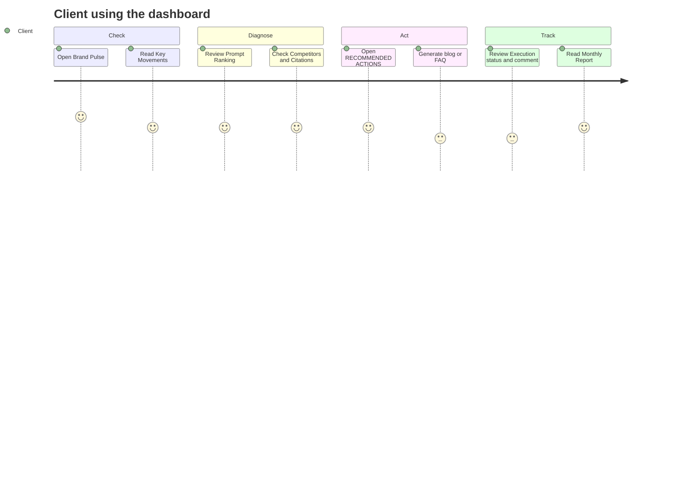

# 03 · Authentication, Roles & User Journey

## Login sequence (observed)

Alternative entries: **Continue with Google**, **Create one** (sign up), **Forgot password** (`/reset-password`), and **Reset session** (clears a stuck session).

## Roles and permissions

| Role / check | Source | Effect |
|---|---|---|
| `admin` | `has_role(_role:'admin')` | Admin console (`/admin/*`) and all brands |
| `internal_team` | `has_role` | Staff tools, brand override |
| `sub_admin` | `has_role` + `sub_admin_brands` | Manages a specific set of brands |
| SEO team member | `is_seo_team_member()` | Edit rights on execution records |
| Schema markup manager | `is_schema_markup_manager()` | Schema Markup editing |
| Normal client user | default | Read access to own brand, can comment and approve on execution rows |

The roles above come from the bundle and RPC names. The mapping of role to page is inferred, and only the client view was tested.

## Client onboarding / subscription journey

Pre-auth values (`preAuthBrandName`, `preAuthName`, `preAuthWebsiteUrl`) are held in localStorage so the brand a visitor typed before signing up carries into onboarding.

## Typical daily client journey

