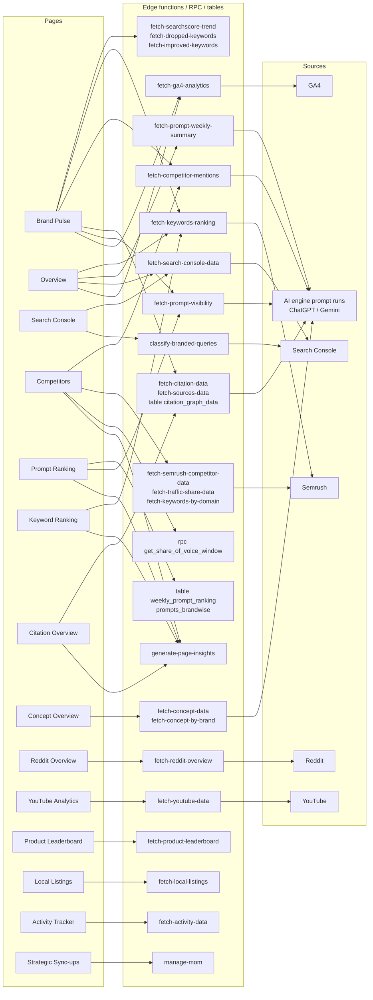
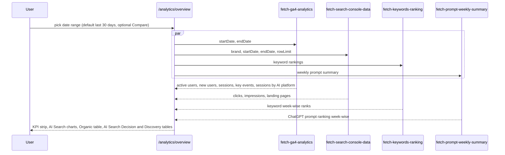
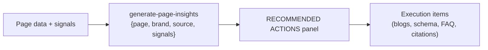
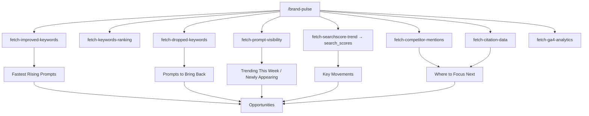

# 04 · Analytics Data Flow

Maps each analytics page to the backend call that feeds it and the source data behind it. Calls were captured from the network log. The upstream source is inferred from the function name and what the page displays.

## Page → function → source

## Overview page in detail

The Overview page loads four functions in parallel and renders them in two blocks.

Observed values for the test brand: 379 active users, 346 new users, 543 sessions over Oct 14 to Nov 12 2026. chatgpt.com drives 44 of the 53 AI-search sessions (about 83%).

## Metric glossary

| Metric | Meaning on the dashboard |
|---|---|
| Visibility % (Gemini / ChatGPT) | Share of tracked prompts in which the brand appears in that engine's answer |
| Share of Voice | Brand mentions relative to competitors across tracked prompts (`get_share_of_voice_window` over `p_days`, `p_offset`, `p_limit`) |
| Citations | Times a brand domain is cited as a source in AI answers |
| Concepts + sentiment | Topics associated with the brand in AI answers, split positive, neutral or negative |
| Authority score | Semrush domain authority (page notes "Last updated: July 2026") |
| AI Search Decision / Discovery tables | Landing pages receiving AI-referred sessions, bucketed by funnel intent (inferred) |

## Insight generation loop

Used on Competitors, Prompt Ranking, Keyword Ranking and Citations.

## Brand Pulse (home) flow

