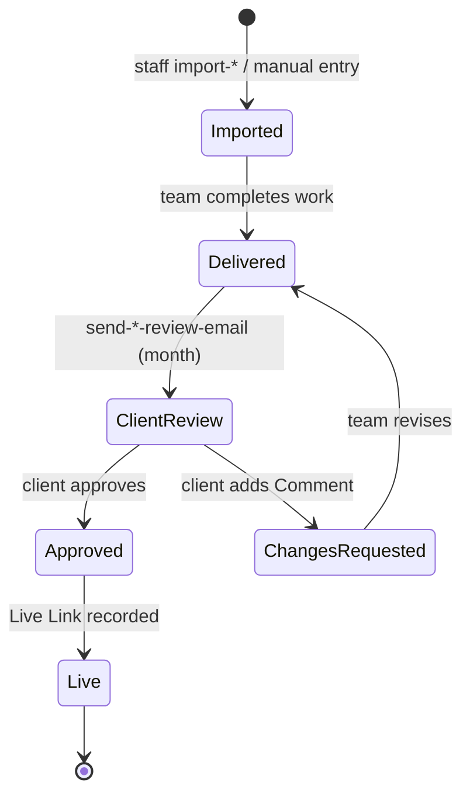
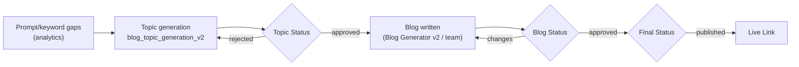
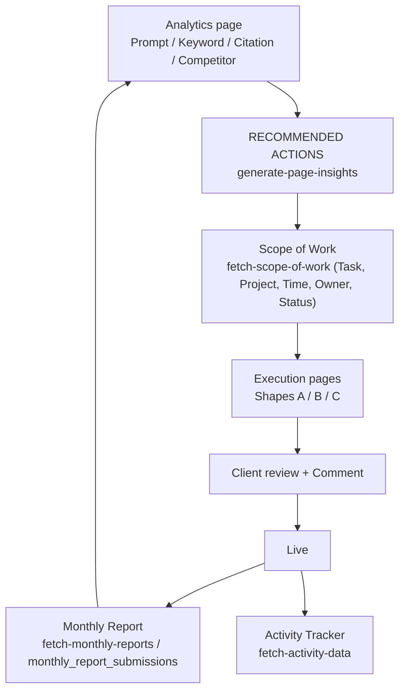

# 05 · Execution Workflow

The Execution section is where the DareAISearch team does the SEO/GEO work and the client reviews it. There are 17 visible pages in three shapes.

## Shape A: reviewable record tables (on-page)

| Page | Table | Columns |
|---|---|---|
| Image Alt | `execution_image_alt_records` | Website Page URL, Image URL, Current ALT, Suggested ALT, Status, Comment |
| Schema Markup | `execution_schema_markup_records` | Page URL, Missing Schema, Recommended Schema, Status, Comment |
| Internal Linking | `execution_internal_linking` | Page URL, Anchor Text, Interlinking To, Status, Comment |
| FAQ Suggestion | `execution_faq_suggestions` | Page URL, Suggested Question, Suggested Answer, Status, Comment |
| YouTube | `execution_youtube_records` + `youtube_column_layouts` | Keyword, Optimized Title/Description/Tags, File Name, Thumbnail Name, First Comment, Playlist, Video URL, Status |
| Meta Tags | `meta_tag_items`, `meta_tag_column_layouts`, `meta_tag_notify_state` | per brand and month, with notify state |

## Shape B: off-page link/citation lists (month-based)

All share the columns **Links · Status · Comment** (Community Reviews adds *Review*).

| Page | Table |
|---|---|
| Profile Citation | `execution_profile_citation_records` |
| Guest Post | `execution_guest_post_records` |
| Web 2.0 | `execution_web2_records` |
| Listing in Online Communities | `execution_listing_online_communities_records` |
| Social Citation | `execution_social_citation_records` |
| Classified | `execution_classified_records` |
| Image Submission | `execution_image_submission_records` |
| Directories | `execution_directories_records` |
| PPT/PDF Submission | `execution_ppt_pdf_submission_records` |
| Reviews on Online Communities | `execution_review_online_communities_records` |
| Reddit/Quora | `execution_reddit_quora_records` (Question, Answer, Live Link) |

Each of these pages also calls two staff-side functions: `import-<type>` (bulk-import links for a brand) and `send-<type>-review-email` (`{action, brand_name, month}`). Both returned **403** for the test client account, so they are staff-only actions the client UI does not use.

## Shape C: content pipeline (Blogs)

`/execution/blogs` combines `blog_topic_generation_v2`, `team_members`, `brands` and `fetch-execution-blogs`. Its columns are Blog Topic, Primary Keyword, **Topic Status**, **Blog Status**, **Final Status** and Live Link.

## Row lifecycle: on-page and off-page records

The exact status labels were not visible (the test brand's tables were mostly empty), so this is the general shape implied by the Status, Comment, Month and review-email fields.

## Blog pipeline (Topic → Blog → Final)

## End-to-end: from insight to execution

