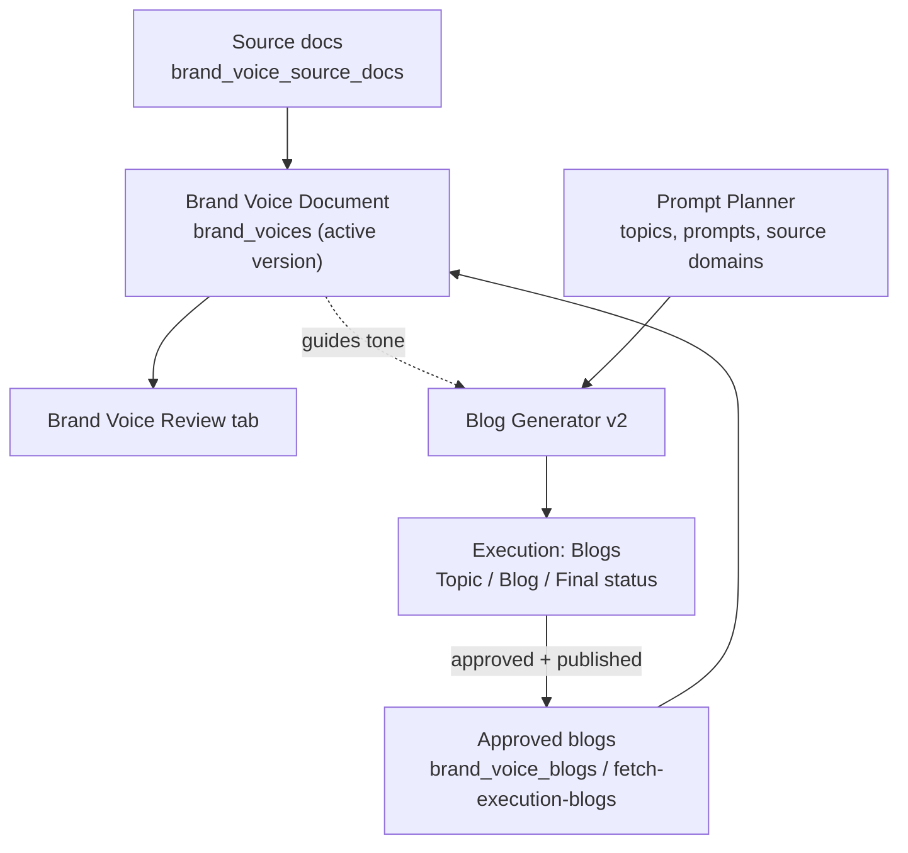
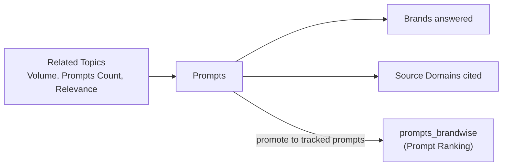
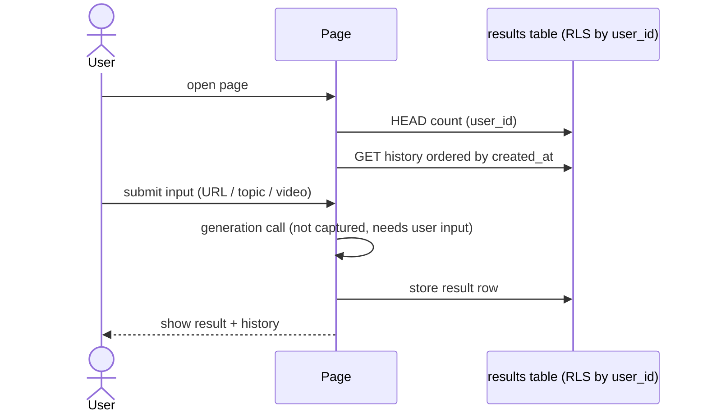
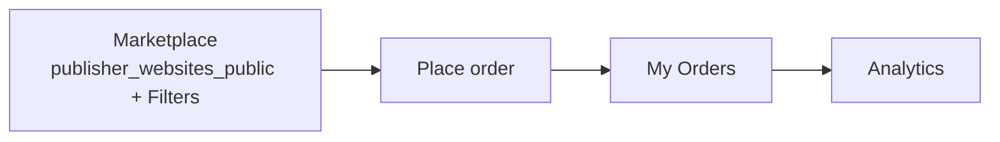

# 06 · Intelligence & Content-Generation Workflows

The Intelligence menu holds the tools that create content or research. Only calls actually seen are listed. Several of these pages call their generation endpoints only after a user action, which a read-only crawl does not trigger.

## Tools overview

| Tool | Route | What it does (as seen) | Data touched |
|---|---|---|---|
| Brand Voice | `/intelligence/brand-voice` | Tabs: *Brand Voice Document*, *Brand Voice Review*. Lists Approved Blogs used to learn the voice. | `brand_voice_settings`, `brand_voices` (is_active), `brand_voice_source_docs` (is_primary), `brand_voice_blogs`, `fetch-execution-blogs` |
| Prompt Planner (BETA) | `/analytics/prompt-research` | Tabs: Related Topics, Prompts, Brands, Source Domains. Topic table: Topic, Volume, Prompts Count, Relevance Score. | (no calls on load, run on demand) |
| Blog Generator v2 | `/blog-generator-v2` | "Requests" list plus topic generation per brand. | `blog_topic_generation_v2`, `blog_column_layouts`, `team_members`, `get_blog_v2_brand_ref` |
| FAQ Creator | `/faq-generator` | Generates and stores FAQ sets per user. | `faq_results` |
| YouTube Intelligence | `/youtube-intelligence` | Generates YouTube optimisation output per user. | `youtube_intelligence_results` |
| Publisher Intelligence | `/intelligence` | Marketplace of publisher websites, with tabs *Marketplace / My Orders / Analytics* and filters. Used to buy placements. | `publisher_websites_public` |

## Brand-voice-driven content loop

## Prompt Planner flow (inferred from tabs)

The final arrow is an inference: access to selecting prompts is gated by `get_prompt_selection_access`.

## FAQ Creator and YouTube Intelligence (shared pattern)

## Publisher Intelligence (marketplace)

## AI chat assistant

A floating sparkle button on every page opens a chat backed by the `analytics-chat` function and the `chat_messages` table, so the user can ask questions about their dashboard data.

## Hidden / staff-only intelligence routes (present in router, not in client sidebar)

`/intelligence/dais-crawler` and `/dais-crawler-v2` (site crawl jobs, with `/report/:jobId`), `/intelligence/competitor-research`, `/intelligence/recommendations`, `/intelligence/visibility-overview`, `/hdie` (+ `/backfill`, `/intelligence`), `/prompt-generator`, `/blog-generator` (v1). Purposes are guessed from names only and were not opened.
