# Page Catalog (all 42 crawled pages)

Generated from a live read-only crawl of app.dareaisearch.com (Herbal Chakra brand, Pro User). Per page: headings, tabs, table columns and backend calls. Screenshots are in `screenshots/`.

## /brand-pulse

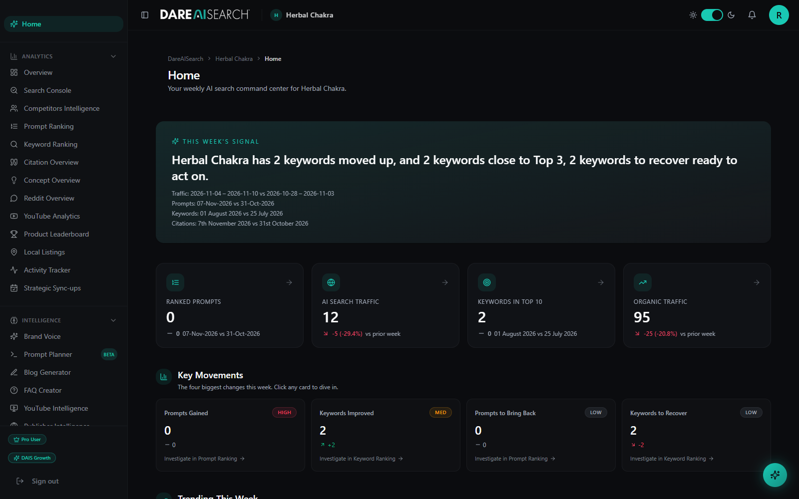

- **Headings:** Home · Key Movements · Trending This Week · Fastest Rising Prompts · Newly Appearing · Prompts to Bring Back · Where to Focus Next · Opportunities · Spots to Win Back · Recommended Actions
- **Backend calls:**
  - `POST FN:fetch-searchscore-trend {brandName} [200]`
  - `POST FN:fetch-dropped-keywords {brandOverride} [200]`
  - `POST FN:fetch-keywords-ranking {brandOverride} [200]`
  - `POST FN:fetch-competitor-mentions {brandOverride} [200]`
  - `POST FN:fetch-improved-keywords {brandOverride} [200]`
  - `POST FN:fetch-citation-data {brandOverride} [200]`
  - `POST FN:fetch-prompt-visibility {brandOverride} [200]`
  - `POST FN:fetch-ga4-analytics {brandOverride,dateRange,startDate,endDate} [200]`

## /analytics/overview

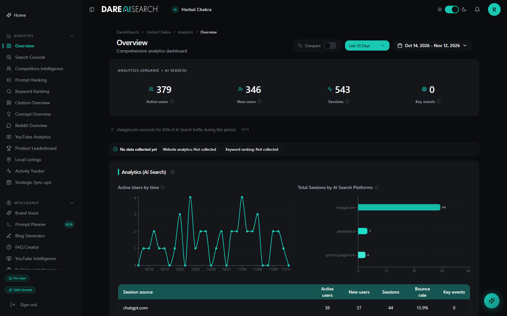

- **Headings:** Overview · ANALYTICS (ORGANIC + AI SEARCH) · Analytics (AI Search) · Analytics (Organic Traffic) · Prompt Ranking Performance Week Wise (ChatGPT) · Keyword Ranking Performance Week Wise · AI Search Decision Table · AI Search Discovery Table
- **Table columns:** Session source · Active users · New users · Sessions · Bounce rate · Key events · # · Landing page · Clicks GSC · Impressions · CTR · Position · Particulars · 07-Nov-2026
- **Backend calls:**
  - `POST FN:fetch-keywords-ranking [200]`
  - `POST FN:fetch-prompt-weekly-summary [200]`
  - `POST FN:fetch-search-console-data {brand,startDate,endDate,rowLimit} [200]`
  - `POST FN:fetch-ga4-analytics {startDate,endDate} [200]`

## /analytics/console-insights

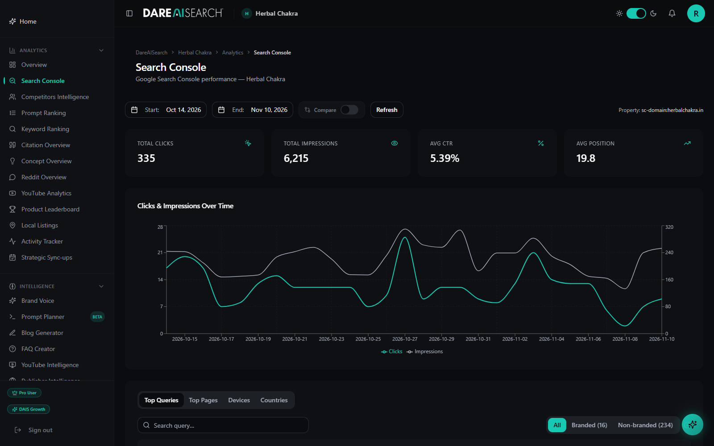

- **Headings:** Search Console · Clicks & Impressions Over Time
- **Tabs:** Top Queries · Top Pages · Devices · Countries
- **Table columns:** Query · Clicks · Impressions · CTR · Position
- **Backend calls:**
  - `POST FN:fetch-search-console-data {brand,startDate,endDate} [200]`
  - `GET REST:brands ?select,name,limit [200]`
  - `POST FN:classify-branded-queries {brand,queries} [200]`

## /analytics/competitors

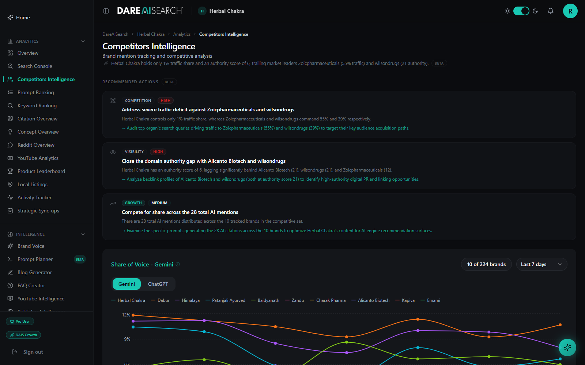

- **Headings:** Competitors Intelligence · RECOMMENDED ACTIONS · Share of Voice - Gemini · Brand's Mention in AI Indexed Sources - ChatGPT · Authority Score Last updated: July 2026 · Domain by Traffic share · Branded Keywords and Non-branded Keywords by Domain
- **Table columns:** Domain · Organic Traffic · Organic Keywords · Backlinks · Ref. Domains · Authority Score
- **Backend calls:**
  - `GET REST:brands ?select,or,limit [200]`
  - `POST FN:fetch-competitor-mentions {brandName,dateRangeDays} [200]`
  - `POST FN:fetch-competitor-mentions {brandName} [200]`
  - `POST FN:fetch-competitor-mentions {brandName,startDate,endDate} [200]`
  - `POST FN:fetch-traffic-share-data [200]`
  - `POST FN:fetch-semrush-competitor-data [200]`
  - `POST FN:fetch-keywords-by-domain [200]`
  - `POST REST:rpc/get_share_of_voice_window {p_brand_name,p_days,p_offset,p_limit} [200]`
  - `POST FN:generate-page-insights {page,brand,source,signals} [200]`

## /analytics/prompt-ranking

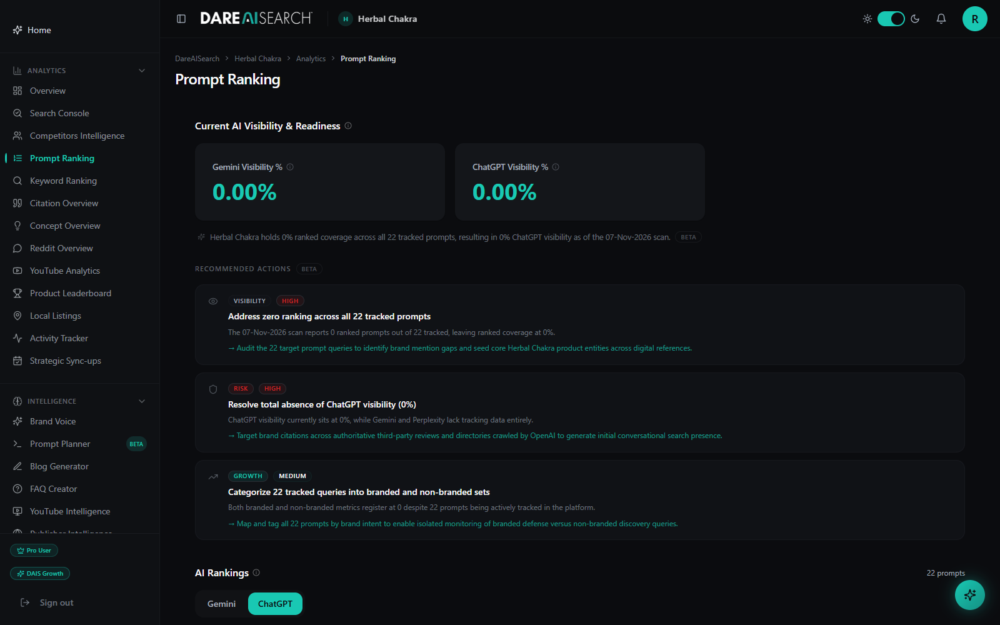

- **Headings:** Prompt Ranking · Current AI Visibility & Readiness · Gemini Visibility % · ChatGPT Visibility % · RECOMMENDED ACTIONS · AI Rankings
- **Table columns:** # · Prompts · 07-Nov-2026 · 31-Oct-2026 · 24-Oct-2026 · 17-Oct-2026 · 10-Oct-2026 · 03-Oct-2026 · 26-Sep-2026 · 19-Sep-2026 · 12-Sep-2026 · 05-Sep-2026 · 29-Aug-2026 · 22-Aug-2026
- **Backend calls:**
  - `GET REST:brand_model_config ?select,brand_name,limit [200]`
  - `GET REST:prompts_brandwise ?select,brand [200]`
  - `POST REST:rpc/get_prompt_selection_access {_brand_name} [200]`
  - `GET REST:weekly_prompt_ranking ?select,brand_name,order,limit [200]`
  - `POST FN:fetch-prompt-visibility [200]`
  - `POST FN:generate-page-insights {page,brand,source,signals} [200]`

## /analytics/keyword-ranking

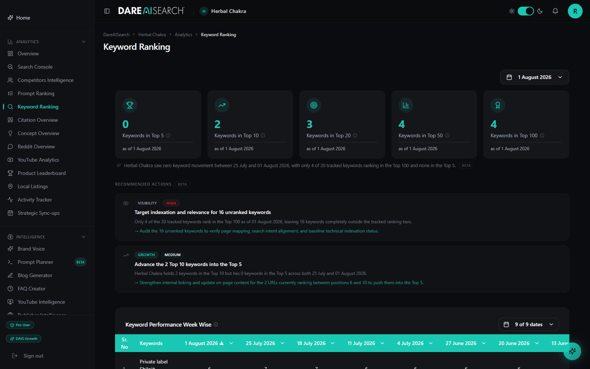

- **Headings:** Keyword Ranking · RECOMMENDED ACTIONS · Keyword Performance Week Wise
- **Table columns:** Sr. No · Keywords · 1 August 2026 ▲ · 25 July 2026 · 18 July 2026 · 11 July 2026 · 4 July 2026 · 27 June 2026 · 20 June 2026 · 13 June 2026 · 6 June 2026
- **Backend calls:**
  - `POST REST:rpc/get_keyword_selection_access {_brand_name} [200]`
  - `POST FN:fetch-keywords-ranking [200]`
  - `POST FN:generate-page-insights {page,brand,source,signals} [200]`

## /analytics/citations

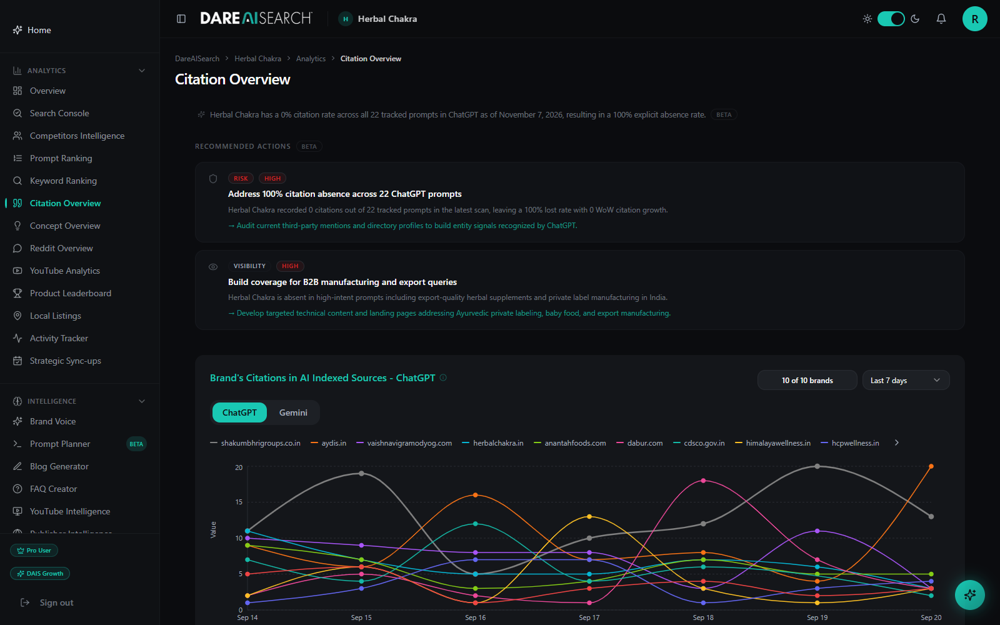

- **Headings:** Citation Overview · RECOMMENDED ACTIONS · Brand's Citations in AI Indexed Sources - ChatGPT · Brand Domain Citations
- **Table columns:** Prompts · 7th November 2026 · 31st October 2026 · 24th October 2026 · 17th October 2026 · 10th October 2026 · 3rd October 2026 · 26th September 2026 · 19th September 2026 · 12th September 2026 · 5th September 2026 · 29th August 2026 · 22nd August 2026 · 15th August 2026
- **Backend calls:**
  - `GET REST:brands ?select,or [200]`
  - `POST FN:fetch-citation-data [200]`
  - `POST FN:fetch-sources-data [200]`
  - `POST FN:fetch-sources-data {startDate,endDate} [200]`
  - `GET REST:citation_graph_data ?select,brand_name,order,offset,limit [200]`
  - `POST FN:generate-page-insights {page,brand,source,signals} [200]`

## /analytics/concepts

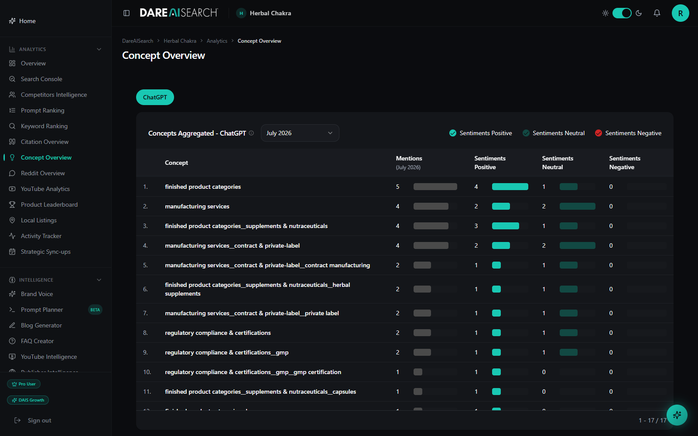

- **Headings:** Concept Overview · Concepts Aggregated - ChatGPT · Concepts by Brand (2026-09-14)
- **Table columns:** Concept · Mentions (July 2026) · Sentiments Positive · Sentiments Neutral · Sentiments Negative · Baidyanath · Dabur · Himalaya · Patanjali Ayurved · herbal chakra
- **Backend calls:**
  - `POST FN:fetch-concept-data [200]`
  - `POST FN:fetch-concept-by-brand [200]`

## /analytics/reddit-overview

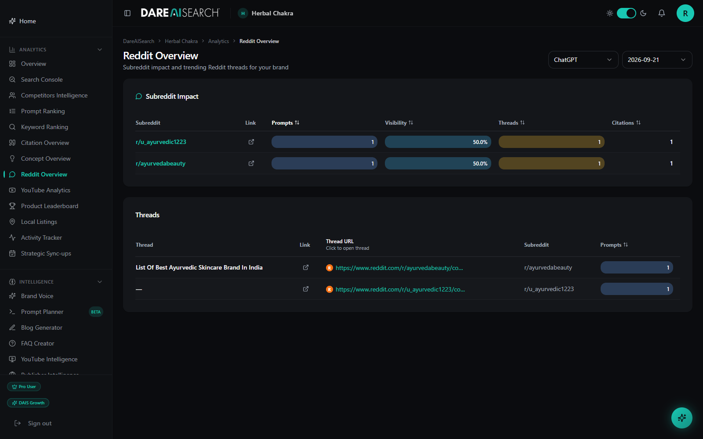

- **Headings:** Reddit Overview · Subreddit Impact · Threads
- **Table columns:** Subreddit · Link · Prompts · Visibility · Threads · Citations · Thread · Thread URL Click to open thread
- **Backend calls:**
  - `POST FN:fetch-reddit-overview [200]`

## /analytics/youtube

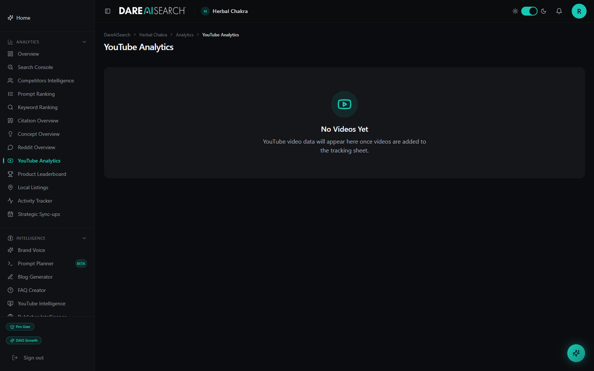

- **Headings:** YouTube Analytics · No Videos Yet
- **Backend calls:**
  - `POST FN:fetch-youtube-data [200]`

## /analytics/product-leaderboard

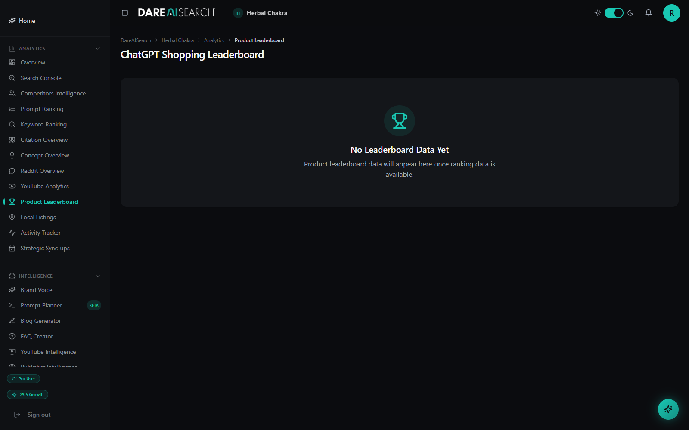

- **Headings:** ChatGPT Shopping Leaderboard · No Leaderboard Data Yet
- **Backend calls:**
  - `POST FN:fetch-product-leaderboard [200]`

## /analytics/local-listings

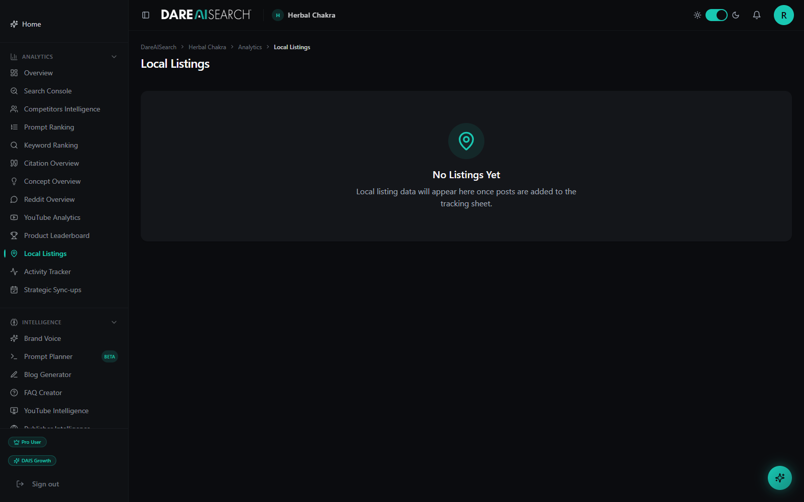

- **Headings:** Local Listings · No Listings Yet
- **Backend calls:**
  - `POST FN:fetch-local-listings [200]`

## /analytics/activity

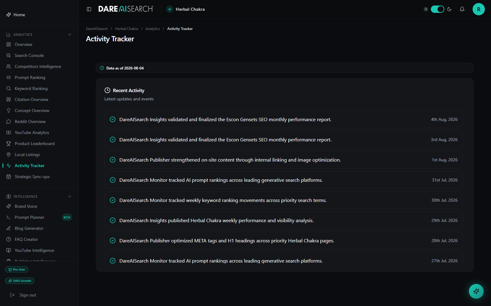

- **Headings:** Activity Tracker · Recent Activity
- **Backend calls:**
  - `POST FN:fetch-activity-data [200]`

## /analytics/brand-mom

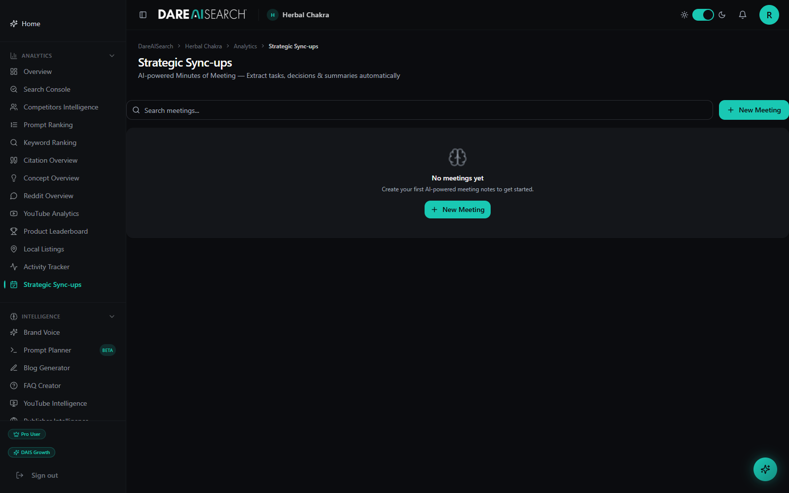

- **Headings:** Strategic Sync-ups · No meetings yet
- **Backend calls:**
  - `GET REST:sub_admin_brands ?select,brand_name [200]`
  - `POST FN:manage-mom {action,brand_name} [200]`

## /intelligence/brand-voice

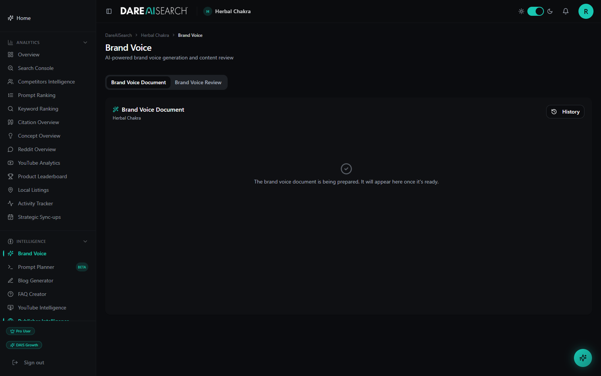

- **Headings:** Brand Voice · Approved Blogs · Brand Voice Document
- **Tabs:** Brand Voice Document · Brand Voice Review
- **Backend calls:**
  - `GET REST:brand_voice_settings ?select,brand_name [200]`
  - `GET REST:brand_voices ?select,brand_name,is_active,order,limit [200]`
  - `GET REST:brand_voice_source_docs ?select,brand_name,is_primary,order,limit [200]`
  - `GET REST:brand_voice_blogs ?select,brand_name,order [200]`
  - `POST FN:fetch-execution-blogs {brandOverride} [200]`

## /analytics/prompt-research

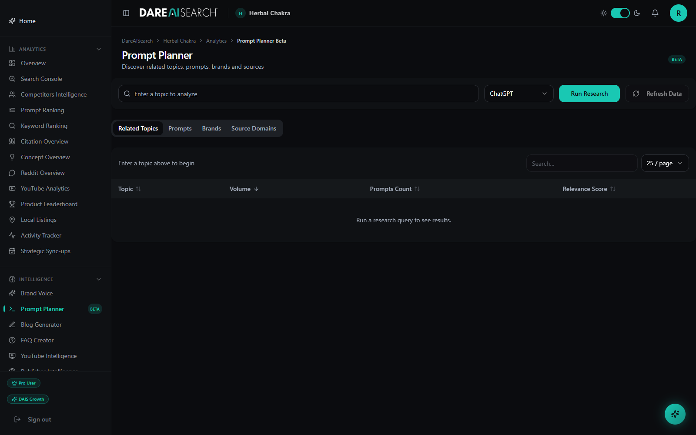

- **Headings:** Prompt Planner
- **Tabs:** Related Topics · Prompts · Brands · Source Domains
- **Table columns:** Topic · Volume · Prompts Count · Relevance Score
- **Backend calls:** none beyond session/auth

## /blog-generator-v2

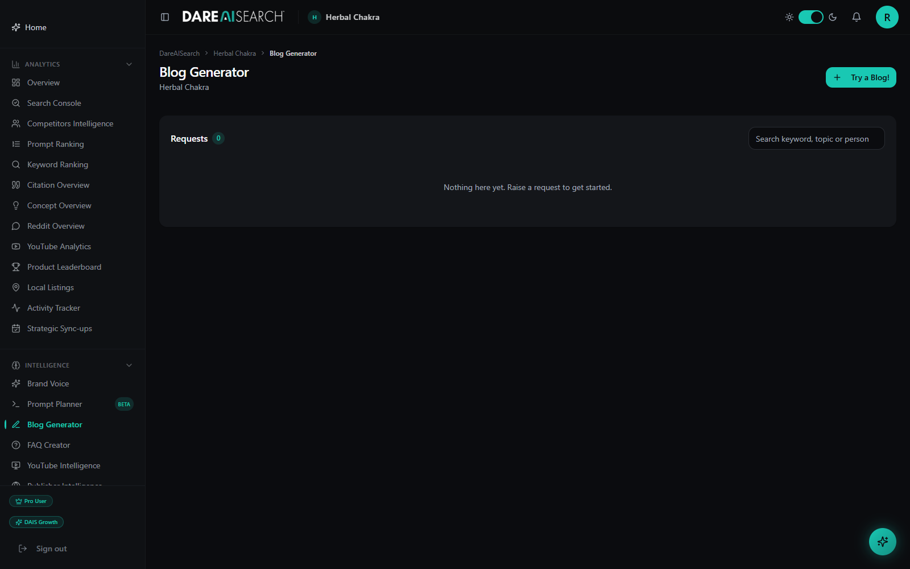

- **Headings:** Blog Generator · Requests
- **Backend calls:**
  - `GET REST:team_members ?select,limit [200]`
  - `GET REST:blog_column_layouts ?select,brand_name,limit [200]`
  - `GET REST:brands ?select,name,limit [200]`
  - `POST REST:rpc/get_blog_v2_brand_ref {_name} [200]`
  - `GET REST:blog_topic_generation_v2 ?select,brand_id,order,limit [200]`

## /faq-generator

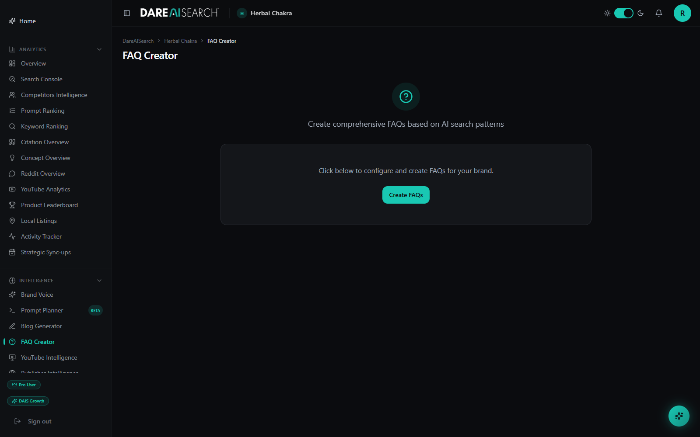

- **Headings:** FAQ Creator
- **Backend calls:**
  - `HEAD REST:faq_results ?select,user_id [200]`
  - `GET REST:faq_results ?select,user_id,created_at,order [200]`

## /youtube-intelligence

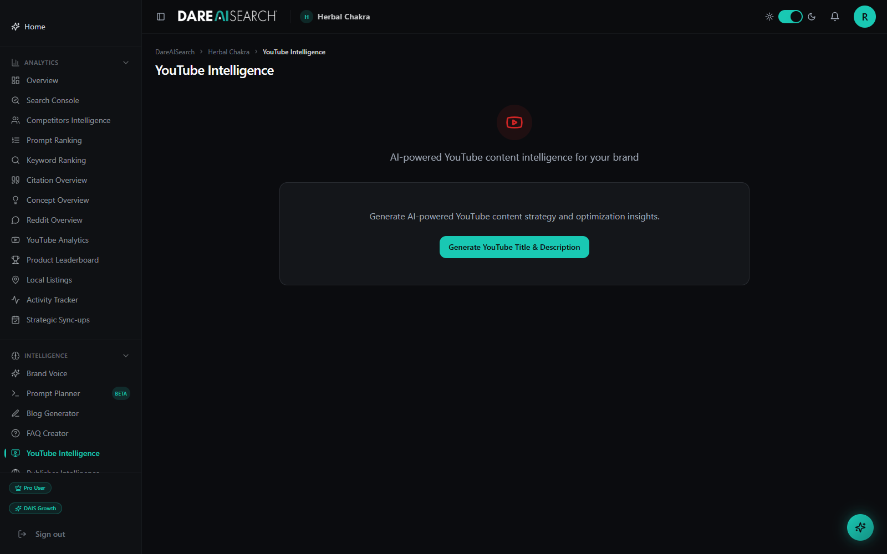

- **Headings:** YouTube Intelligence
- **Backend calls:**
  - `HEAD REST:youtube_intelligence_results ?select,user_id [200]`
  - `GET REST:youtube_intelligence_results ?select,user_id,created_at,order [200]`

## /intelligence

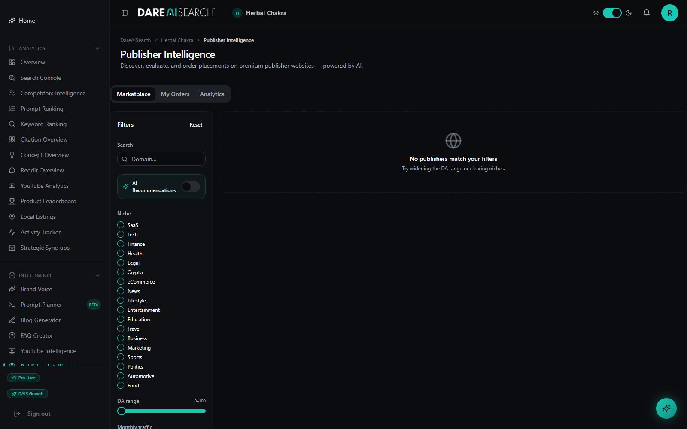

- **Headings:** Publisher Intelligence · Filters
- **Tabs:** Marketplace · My Orders · Analytics
- **Backend calls:**
  - `GET REST:publisher_websites_public ?select,order [200]`

## /execution/blogs

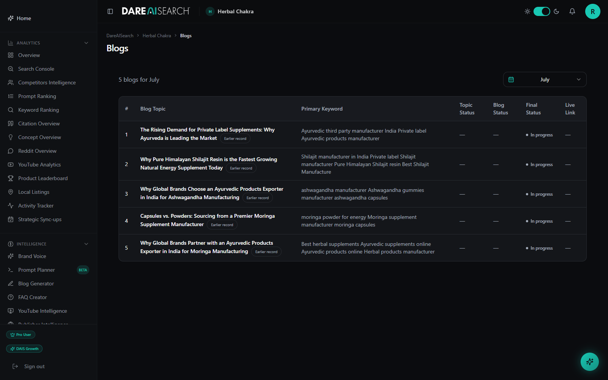

- **Headings:** Blogs
- **Table columns:** # · Blog Topic · Primary Keyword · Topic Status · Blog Status · Final Status · Live Link
- **Backend calls:**
  - `GET REST:team_members ?select,limit [200]`
  - `GET REST:brands ?select,name,limit [200]`
  - `POST REST:rpc/get_blog_v2_brand_ref {_name} [200]`
  - `GET REST:blog_topic_generation_v2 ?select,brand_id,order,limit [200]`
  - `POST FN:fetch-execution-blogs [200]`

## /execution/meta-tags

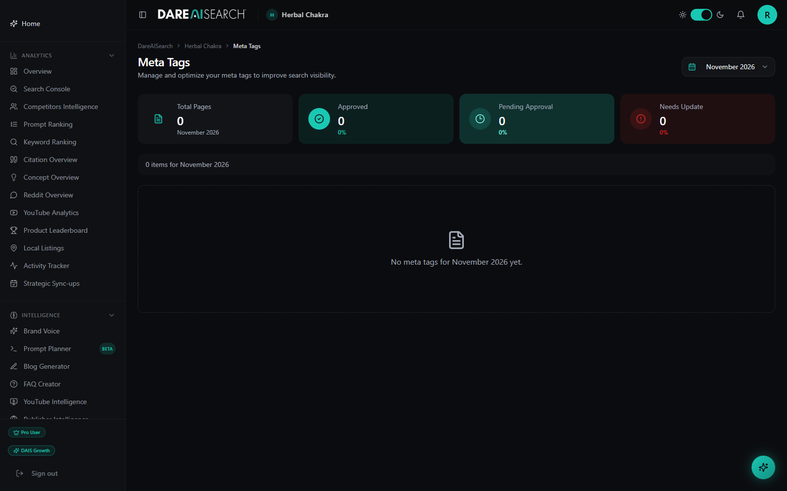

- **Headings:** Meta Tags
- **Backend calls:**
  - `GET REST:brands ?select,name,limit [200]`
  - `POST REST:rpc/is_meta_tag_internal [200]`
  - `GET REST:brands ?select,username_api,limit [200]`
  - `POST REST:rpc/get_blog_v2_brand_ref {_name} [200]`
  - `GET REST:meta_tag_column_layouts ?select,brand_id [200]`
  - `GET REST:meta_tag_items ?select,brand_id,order,limit [200]`
  - `GET REST:meta_tag_notify_state ?select,brand_id,month [200]`

## /execution/image-alt

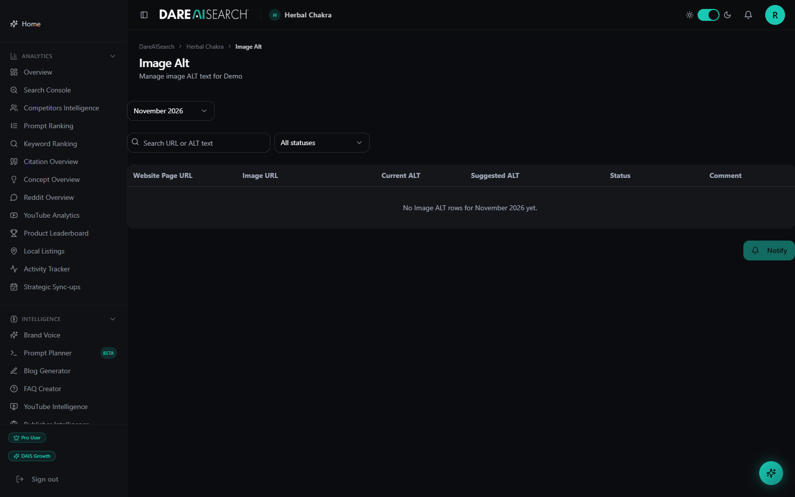

- **Headings:** Image Alt
- **Table columns:** Website Page URL · Image URL · Current ALT · Suggested ALT · Status · Comment
- **Backend calls:**
  - `GET REST:execution_image_alt_records ?select,order,limit [200]`

## /execution/schema-markup

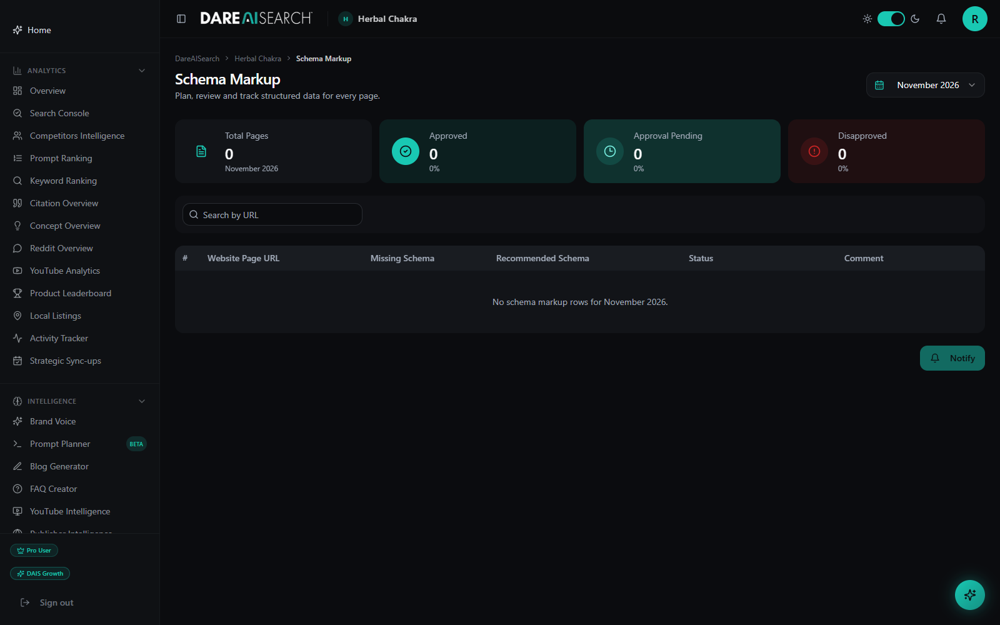

- **Headings:** Schema Markup
- **Table columns:** # · Website Page URL · Missing Schema · Recommended Schema · Status · Comment
- **Backend calls:**
  - `GET REST:execution_schema_markup_records ?select,order,limit [200]`

## /execution/internal-linking

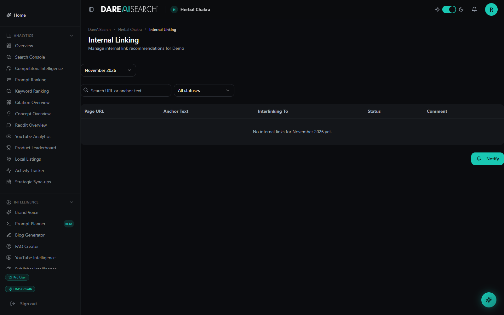

- **Headings:** Internal Linking
- **Table columns:** Page URL · Anchor Text · Interlinking To · Status · Comment
- **Backend calls:**
  - `GET REST:execution_internal_linking ?select,order,limit [200]`

## /execution/faq-suggestion

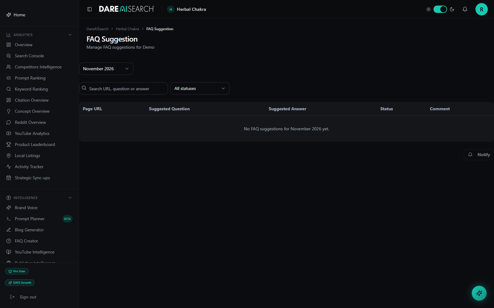

- **Headings:** FAQ Suggestion
- **Table columns:** Page URL · Suggested Question · Suggested Answer · Status · Comment
- **Backend calls:**
  - `GET REST:execution_faq_suggestions ?select,order,limit [200]`

## /execution/youtube

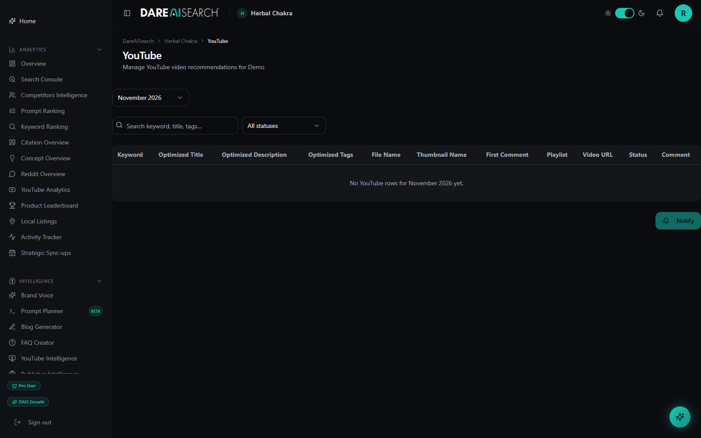

- **Headings:** YouTube
- **Table columns:** Keyword · Optimized Title · Optimized Description · Optimized Tags · File Name · Thumbnail Name · First Comment · Playlist · Video URL · Status · Comment
- **Backend calls:**
  - `POST REST:rpc/current_user_brand_name [200]`
  - `GET REST:youtube_column_layouts ?select,brand_name [200]`
  - `GET REST:execution_youtube_records ?select,source,order,limit [200]`

## /execution/profile-citation

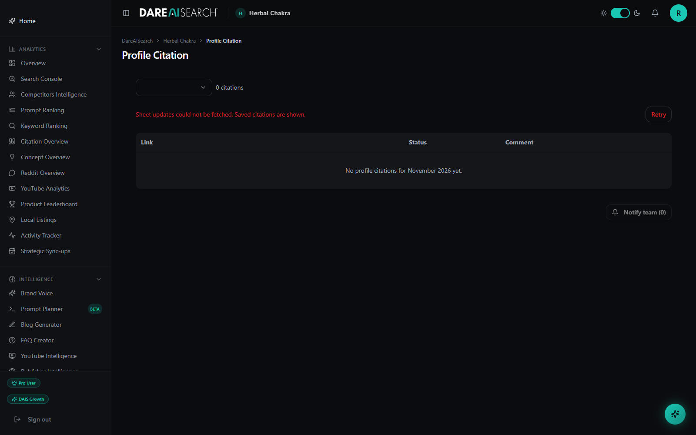

- **Headings:** Profile Citation
- **Table columns:** Link · Status · Comment
- **Backend calls:**
  - `POST FN:import-profile-citation {brand_name} [403]`
  - `POST FN:send-profile-citation-review-email {action,brand_name,month} [403]`
  - `GET REST:execution_profile_citation_records ?select,order,offset,limit [200]`

## /execution/guest-post

- **Headings:** Guest Post
- **Table columns:** Links · Status · Comment
- **Backend calls:**
  - `POST FN:import-guest-post {brand_name} [403]`
  - `GET REST:execution_guest_post_records ?select,order,limit [200]`
  - `POST FN:send-guest-post-review-email {action,brand_name,month} [403]`

## /execution/web-two

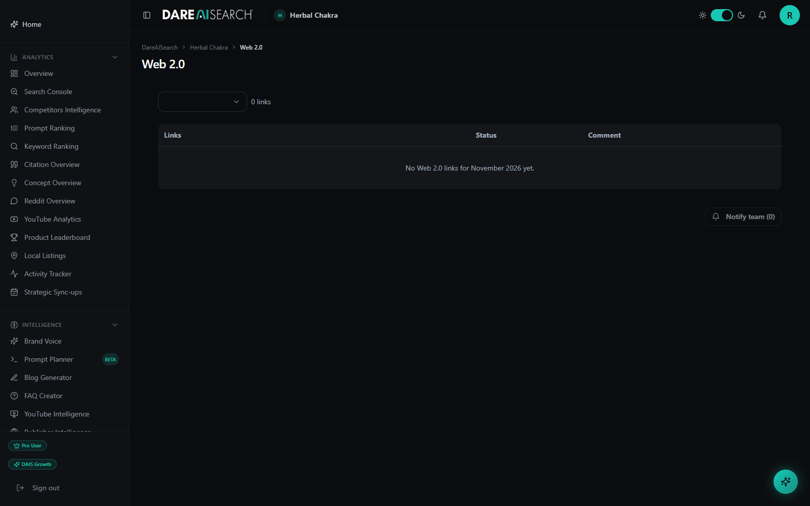

- **Headings:** Web 2.0
- **Table columns:** Links · Status · Comment
- **Backend calls:**
  - `POST FN:import-web-two {brand_name} [403]`
  - `GET REST:execution_web2_records ?select,order,limit [200]`
  - `POST FN:send-web-two-review-email {action,brand_name,month} [403]`

## /execution/online-communities

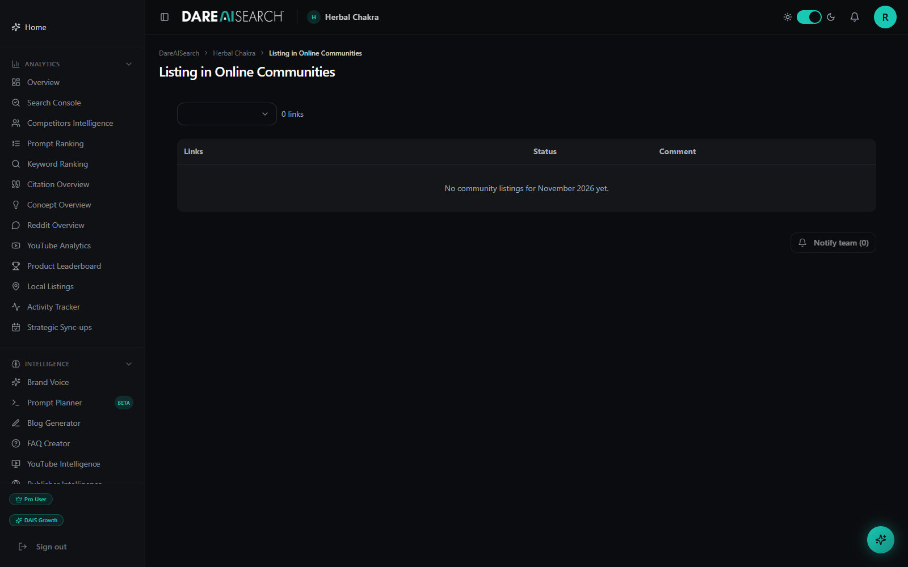

- **Headings:** Listing in Online Communities
- **Table columns:** Links · Status · Comment
- **Backend calls:**
  - `POST FN:import-online-communities {brand_name} [403]`
  - `GET REST:execution_listing_online_communities_records ?select,order,limit [200]`
  - `POST FN:send-online-communities-review-email {action,brand_name,month} [403]`

## /execution/social-citation

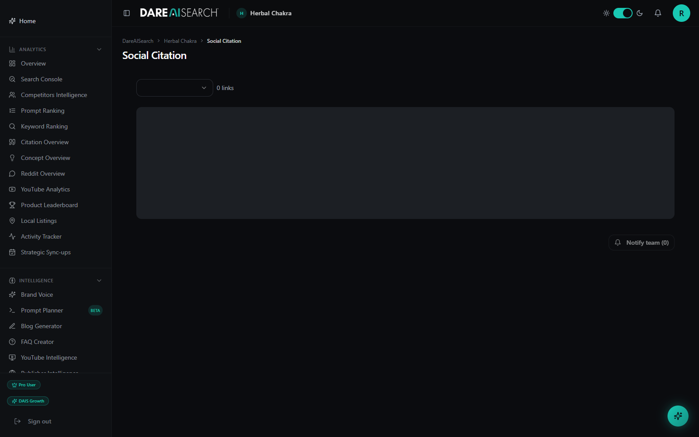

- **Headings:** Social Citation
- **Backend calls:**
  - `POST FN:import-social-citation {brand_name} [403]`
  - `POST FN:send-social-citation-review-email {action,brand_name,month} [403]`
  - `GET REST:execution_social_citation_records ?select,order,limit [500]`

## /execution/classified

- **Headings:** Classified
- **Table columns:** Links · Status · Comment
- **Backend calls:**
  - `POST FN:send-classified-review-email {action,brand_name,month} [403]`
  - `POST FN:import-classified {brand_name} [403]`
  - `GET REST:execution_classified_records ?select,order,limit [200]`

## /execution/reddit

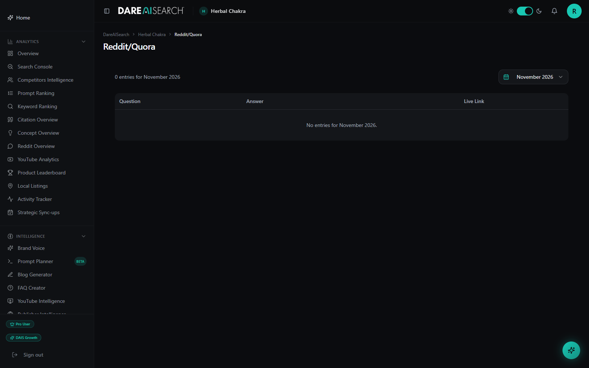

- **Headings:** Reddit/Quora
- **Table columns:** Question · Answer · Live Link
- **Backend calls:**
  - `GET REST:execution_reddit_quora_records ?select,brand_name,order,limit [200]`

## /execution/image-submission

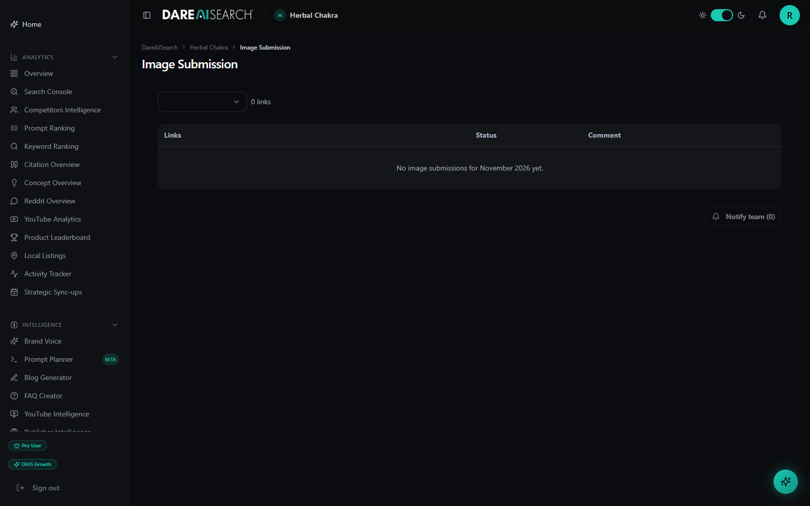

- **Headings:** Image Submission
- **Table columns:** Links · Status · Comment
- **Backend calls:**
  - `POST FN:import-image-submission {brand_name} [403]`
  - `POST FN:send-image-submission-review-email {action,brand_name,month} [403]`
  - `GET REST:execution_image_submission_records ?select,order,limit [200]`

## /execution/directories

- **Headings:** Directories
- **Table columns:** Links · Status · Comment
- **Backend calls:**
  - `GET REST:execution_directories_records ?select,order,limit [200]`
  - `POST FN:import-directories {brand_name} [403]`
  - `POST FN:send-directories-review-email {action,brand_name,month} [403]`

## /execution/ppt-pdf-submission

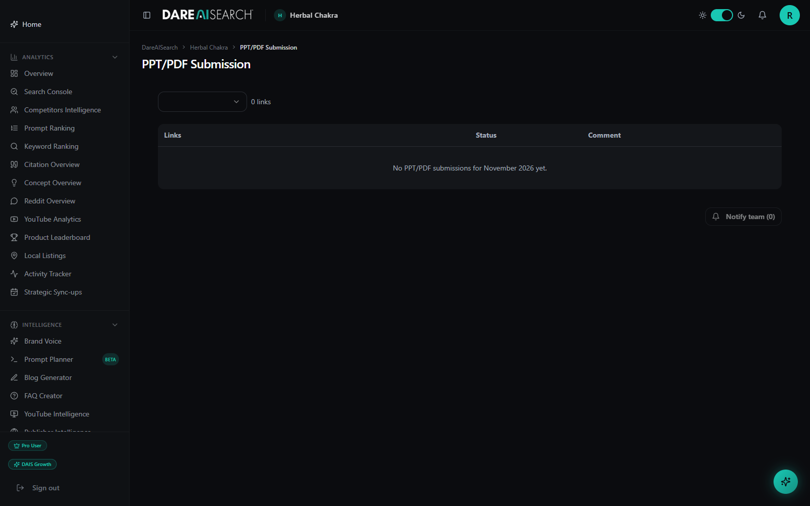

- **Headings:** PPT/PDF Submission
- **Table columns:** Links · Status · Comment
- **Backend calls:**
  - `POST FN:import-ppt-pdf-submission {brand_name} [403]`
  - `POST FN:send-ppt-pdf-review-email {action,brand_name,month} [403]`
  - `GET REST:execution_ppt_pdf_submission_records ?select,order,limit [200]`

## /execution/community-reviews

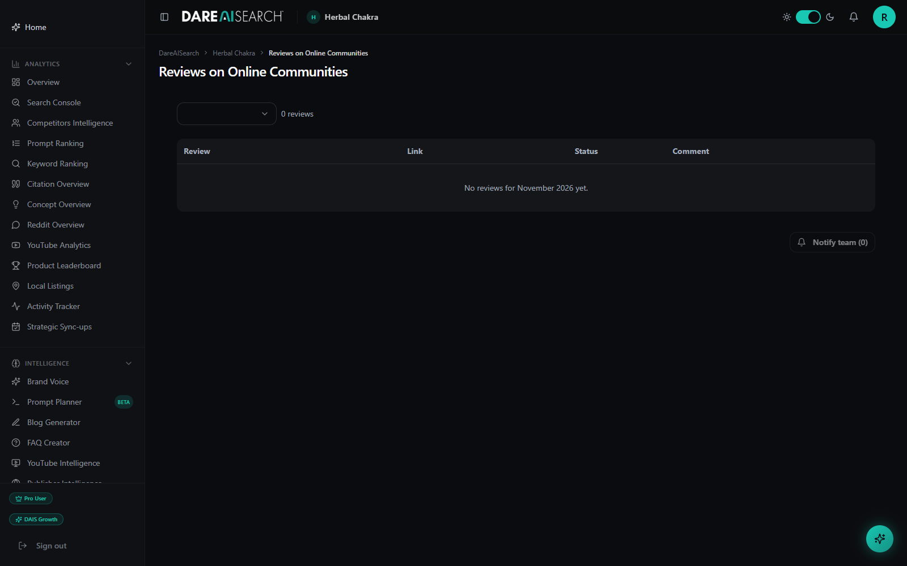

- **Headings:** Reviews on Online Communities
- **Table columns:** Review · Link · Status · Comment
- **Backend calls:**
  - `GET REST:execution_review_online_communities_records ?select,order,limit [200]`
  - `POST FN:import-community-reviews {brand_name} [403]`
  - `POST FN:send-community-reviews-review-email {action,brand_name,month} [403]`

## /deliverables/scope-of-work

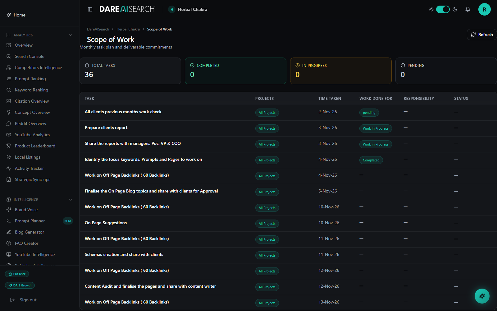

- **Headings:** Scope of Work
- **Table columns:** TASK · PROJECTS · TIME TAKEN · WORK DONE FOR · RESPONSIBILITY · STATUS
- **Backend calls:**
  - `GET FN:fetch-scope-of-work ?brand [200]`

## /reporting/monthly

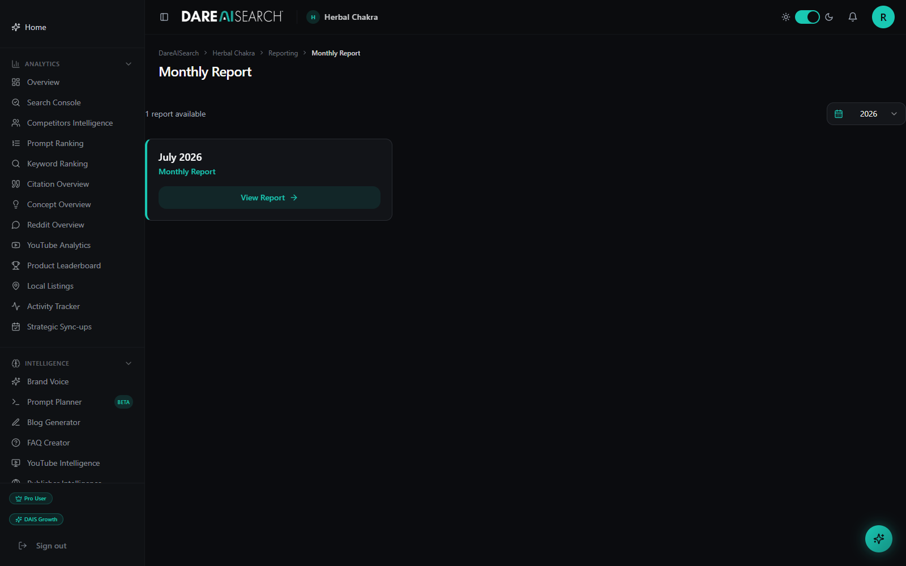

- **Headings:** Monthly Report · July 2026
- **Backend calls:**
  - `GET REST:monthly_report_submissions ?select,order,limit,brand_name [200]`
  - `POST FN:fetch-monthly-reports [200]`

## /insightful-blogs

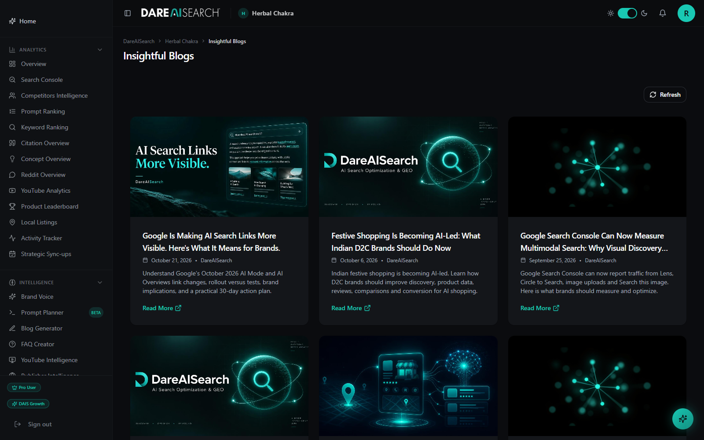

- **Headings:** Insightful Blogs · Google Is Making AI Search Links More Visible. Here's What It Means for Brands. · Festive Shopping Is Becoming AI-Led: What Indian D2C Brands Should Do Now · Google Search Console Can Now Measure Multimodal Search: Why Visual Discovery Just Became a First-Class SEO Metric · ChatGPT Changed What It Cites: Why Building GEO Around Any One Source Is Dangerous · Google Is Changing Local Search in Europe: What Aggregator and Supplier Units Mean for Brands · Google Search Is Becoming More Audience-Driven: Why Search Profiles and Preferred Sources Matter for Brands · Gemini 3.8 Is Another Sign the Search Query Is Becoming a Conversation · Does GEO Actually Drive Revenue? Connecting AI Visibility to Traffic, Leads and Sales · AI Visibility Is Becoming a CMO Metric. But What Should Brands Actually Measure?
- **Backend calls:**
  - `GET REST:knowledge_articles ?select,status,source_type,order,limit [200]`

## /interactive-webinars

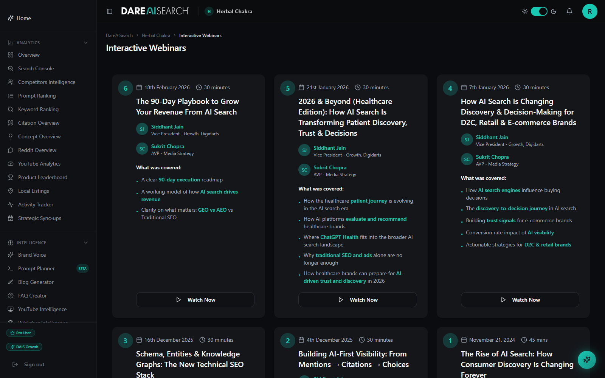

- **Headings:** Interactive Webinars · The 90-Day Playbook to Grow Your Revenue From AI Search · 2026 & Beyond (Healthcare Edition): How AI Search Is Transforming Patient Discovery, Trust & Decisions · How AI Search Is Changing Discovery & Decision-Making for D2C, Retail & E-commerce Brands · Schema, Entities & Knowledge Graphs: The New Technical SEO Stack · Building AI-First Visibility: From Mentions → Citations → Choices · The Rise of AI Search: How Consumer Discovery Is Changing Forever
- **Backend calls:** none beyond session/auth

