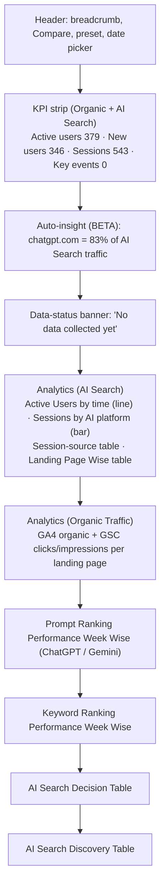
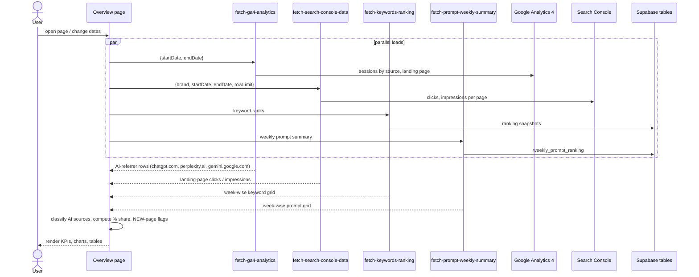

# Analytics → Overview
Route: `/analytics/overview` · Subtitle: "Comprehensive analytics dashboard"

## Purpose
One-screen summary that combines **AI-search traffic** (sessions referred by ChatGPT, Perplexity and Gemini), **organic traffic** (Google), and **week-wise rank tables** for prompts and keywords.

## Controls
Compare toggle · date-range preset (*Last 30 Days*) · date picker (Oct 14 – Nov 12, 2026) · date selector "26 of 26 dates" · engine toggle (ChatGPT / Gemini) on the prompt-ranking block.

## Page layout

## Architecture and data flow

## Key logic (observed)
- **AI-source classification:** GA4 sessions whose source is an AI domain (chatgpt.com, perplexity.ai, gemini.google.com) feed the AI Search block. The "83%" insight is 44 ÷ 53 AI sessions.
- **Landing Page Wise table:** columns Landing page · Active users · New users · Sessions · Key events. Rows carry a **NEW** tag when a page first received AI traffic in the period.
- **Session source table** adds Bounce rate. Totals: 40 active users, 53 sessions, 20.75% bounce.
- **Organic table** joins GA4 sessions with GSC clicks and impressions by landing page.

## Edge cases
| Case | Behaviour |
|---|---|
| Banner says "Website analytics: Not collected / Keyword ranking: Not collected" while GA4 data renders | Contradiction (see [09](../09-observations-and-gaps.md)); the banner likely reads a different status flag than the data calls |
| Google not connected | GA4 and GSC blocks would be empty (inferred from `google_connections`) |
| Key events = 0 | No conversion events configured or fired in GA4 |
