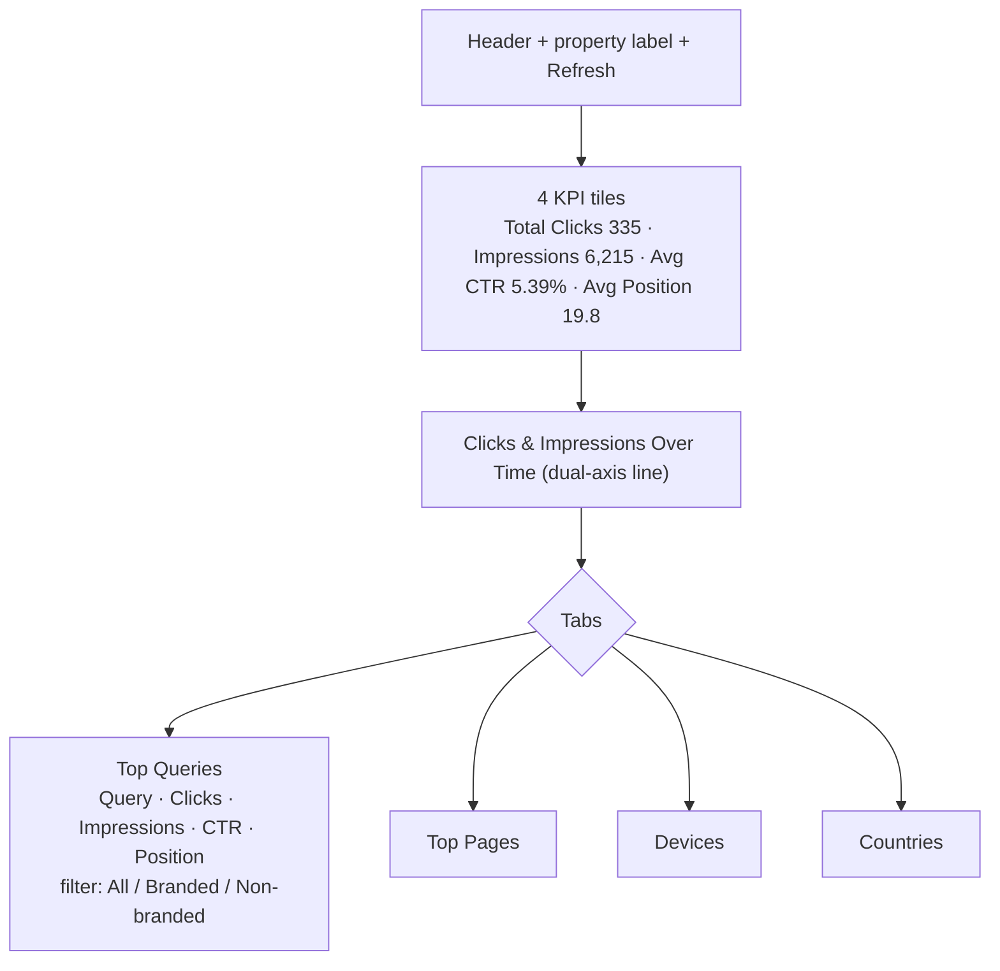
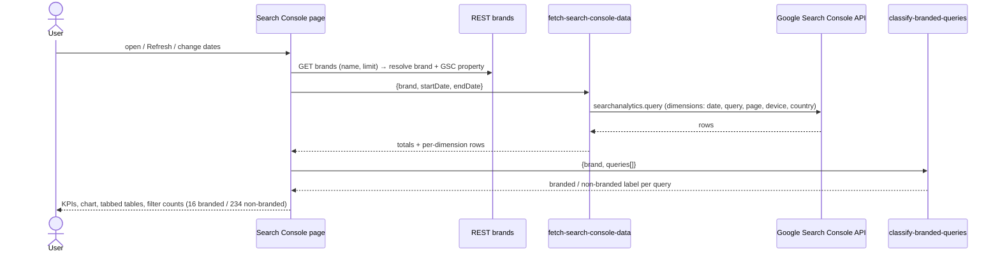

# Analytics → Search Console
Route: `/analytics/console-insights`

## Purpose
Google Search Console performance for the brand's property (`sc-domain:herbalchakra.in`), with automatic **branded vs non-branded** query classification.

## Controls
Start / End date pickers (Oct 14 – Nov 10, 2026) · Compare toggle · **Refresh** · tabs **Top Queries / Top Pages / Devices / Countries** · query filter **All / Branded (16) / Non-branded (234)**.

## Layout

## Architecture and data flow

## Notes
- Authentication to GSC uses the user's Google connection (`google_connections`, `google-oauth-url`). Without it the page cannot load.
- Branded classification is server-side and likely uses the brand name and its variants (e.g. "herbal chakra", "pvt ltd"). Method not visible, so treat as inferred.
- Branded queries dominate clicks (top row "herbal chakra": 113 clicks at position 2.4), while non-branded queries ("shilajit manufacturer", "healthy snacks manufacturers in india") have impressions but low CTR, which is the growth gap.
- Date range ends Nov 10, two days before today, which is consistent with GSC's reporting lag.
