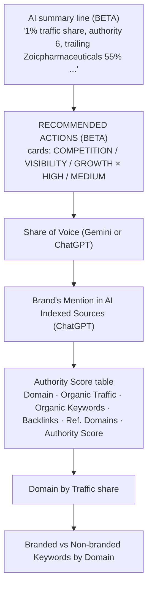
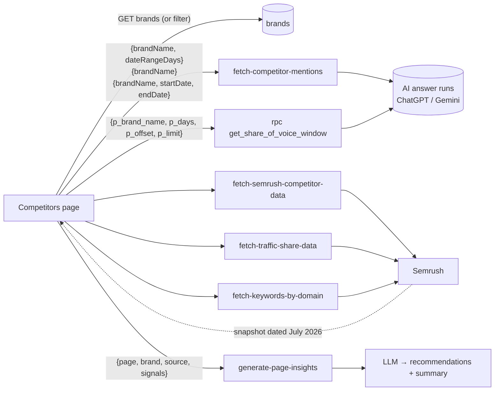
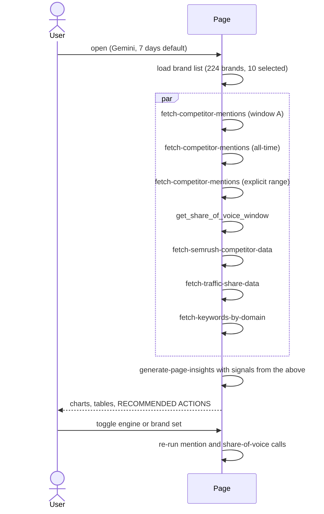

# Analytics → Competitors Intelligence
Route: `/analytics/competitors` · Subtitle: "Brand mention tracking and competitive analysis"

## Purpose
Shows how the brand compares with competitors in three ways: **AI share of voice**, **AI-cited sources**, and **traditional SEO strength** (traffic share, authority, keywords, backlinks).

## Controls
Brand multi-select ("10 of 224 brands") · range "Last 7 days" · engine toggle Gemini / ChatGPT · brand filter on keyword table ("10 of 10 brands").

## Layout

## Architecture and data flow

## Sequence on load

## Observations
- **Two data clocks:** AI mention data is live (last 7 days) while Semrush authority/traffic is a snapshot ("Last updated: July 2026").
- **Recommendation cards** are tagged by category (COMPETITION, VISIBILITY, GROWTH) and priority (HIGH, MEDIUM) and include a concrete next step (e.g. audit top organic queries of the 55%-traffic competitor).
- `fetch-competitor-mentions` is called three times with different parameter sets, an optimisation opportunity.
- The competitor set looks cross-industry (pharma, biotech), so competitor selection is probably brand-configured rather than auto-detected by industry (inferred).
