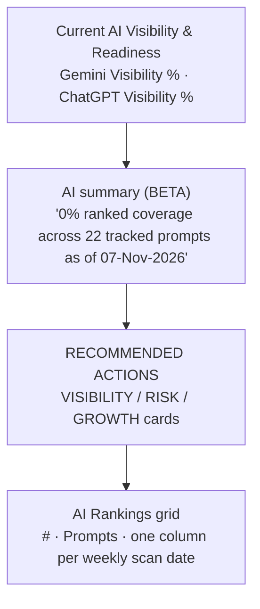
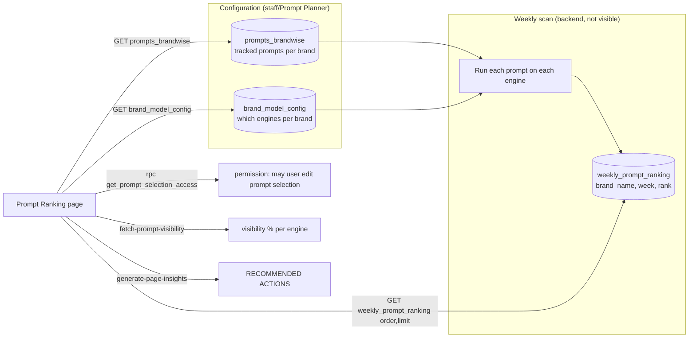
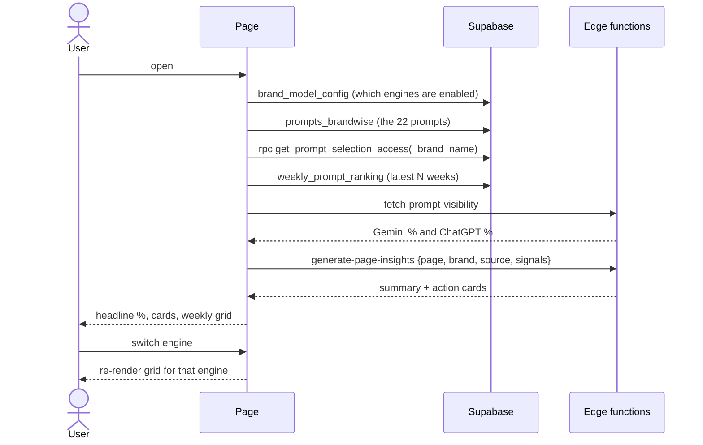

# Analytics → Prompt Ranking
Route: `/analytics/prompt-ranking`

## Purpose
Tracks a fixed set of **prompts** (questions a buyer might ask an AI) and records whether the brand appears, per engine, week after week.

## Controls
Engine toggle **Gemini / ChatGPT** · scan-date columns (weekly, 07-Nov-2026 back to 18-May-2026).

## Layout

## Architecture and data flow

## Sequence

## Metric definitions
- **Visibility %** = prompts where the brand is ranked ÷ total tracked prompts, for the latest scan.
- **Ranked coverage** and "tracked prompts" (22) come from `prompts_brandwise`.
- Perplexity is mentioned in insights ("lack tracking data entirely") but has no toggle, so only Gemini and ChatGPT are scanned.

## Current state for the test brand
0% on both engines, all 22 prompts unranked. The insight cards correspondingly recommend seeding brand entities in third-party sources, categorising branded vs non-branded prompts, and so on.
