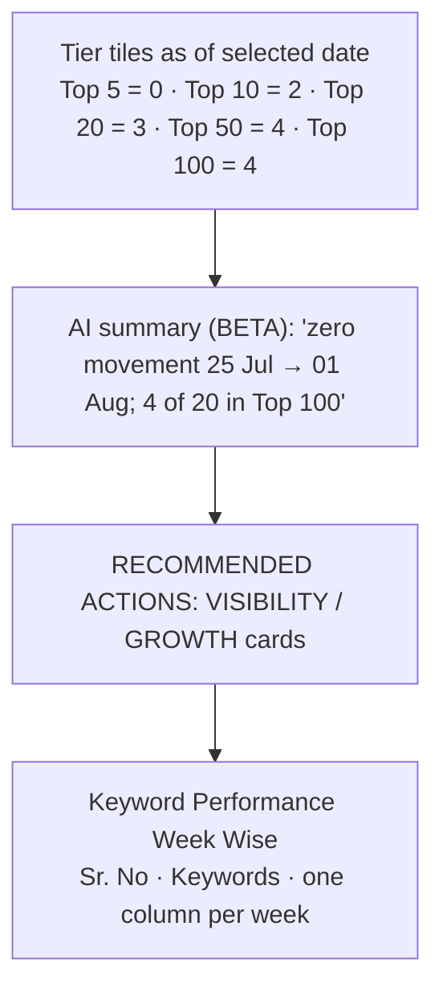
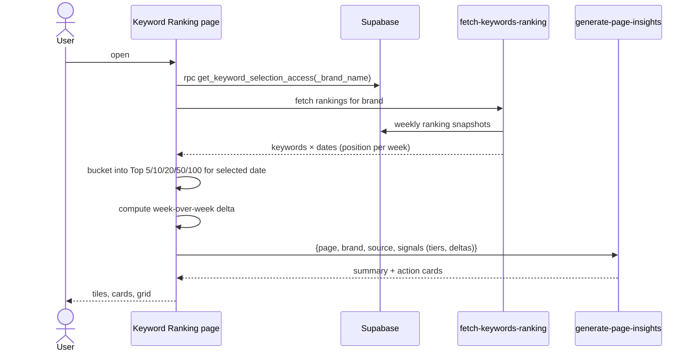

# Analytics → Keyword Ranking
Route: `/analytics/keyword-ranking`

## Purpose
Traditional Google rank tracking for a fixed keyword list (20 for the test brand), shown as tier counts and a week-by-week grid.

## Controls
Date selector (latest "1 August 2026", "9 of 9 dates") · sortable date columns (▲ marks the active sort).

## Layout

## Architecture and data flow

## Logic
- **Tier tiles are cumulative** (Top 10 includes Top 5). Here 0 → 2 → 3 → 4 → 4.
- **Movement** compares the selected date with the previous weekly snapshot, so "zero keyword movement" means identical positions.
- **Unranked** = tracked but outside the top 100 (16 of 20 here).
- Snapshots are **weekly on Saturdays** and the newest in this account is 1 August 2026, about 3 months older than today. Either the tracker stopped or the snapshots are produced manually. Confirm with the team.
- Access to *selecting* keywords is permission-checked (`get_keyword_selection_access`), so staff or the client can edit the keyword list only if allowed.

## Related
Brand Pulse reuses the same function for "Fastest Rising" and "Dropped" views (`fetch-improved-keywords`, `fetch-dropped-keywords`).
