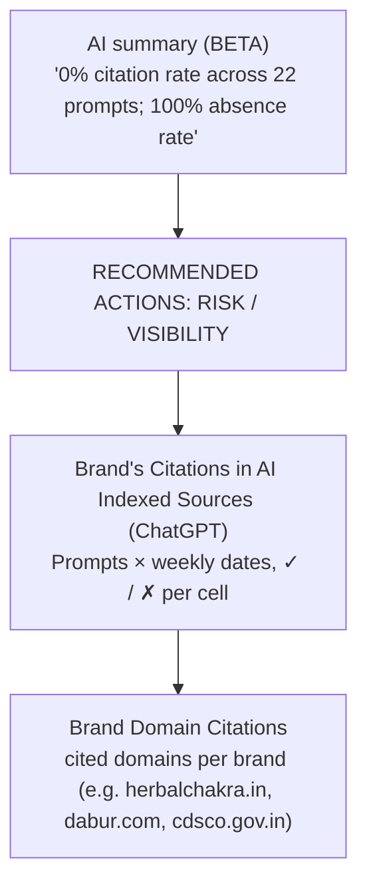
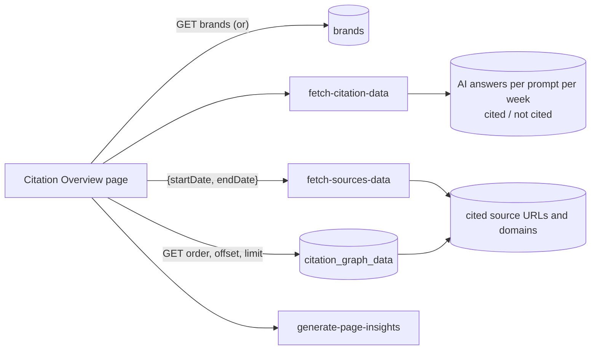
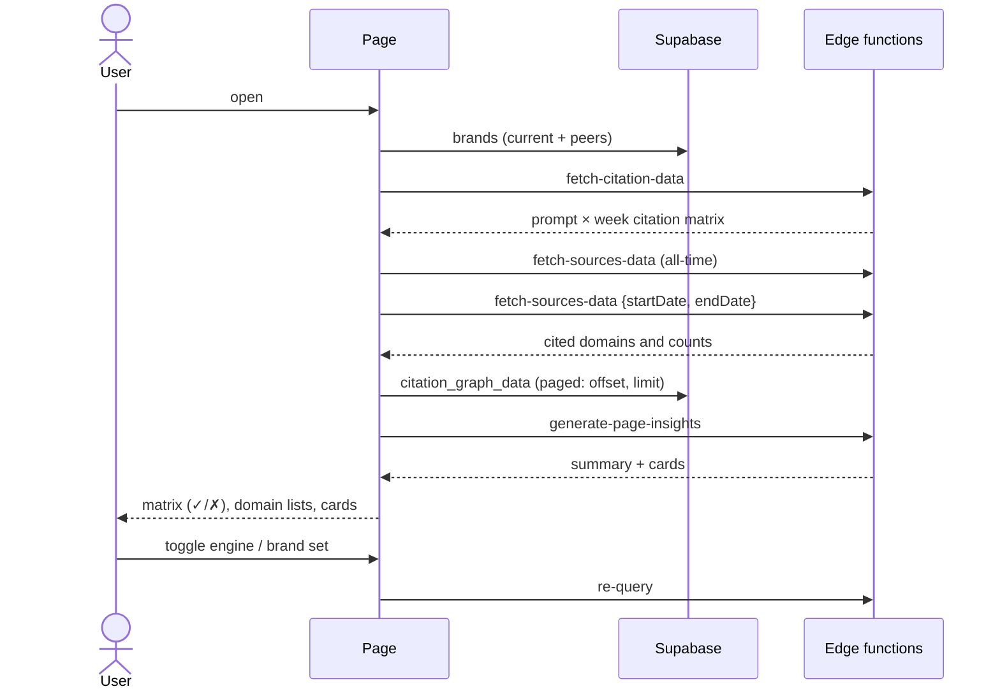

# Analytics → Citation Overview
Route: `/analytics/citations`

## Purpose
Shows **which web sources AI engines cite** when answering the tracked prompts, and whether the brand's own domain is among them.

## Controls
Brand multi-select ("10 of 10 brands") · range "Last 7 days" · engine toggle ChatGPT / Gemini.

## Layout

## Architecture and data flow

## Sequence

## Definitions
- **Citation rate** = prompts where the brand's domain appears among cited sources ÷ tracked prompts.
- **Absence rate** = 1 − citation rate (here 100%).
- **WoW citation growth** = change in citations vs the prior week (0 here).
- **Brand Domain Citations** list shows peers' domains too (dabur.com, himalaya...), so it is also a source-gap tool: domains AI trusts that the brand is not on.

## Relationship to Execution
Gaps found here feed the off-page execution pages (Profile Citation, Directories, Guest Post, Reddit/Quora, etc.). See [../05-execution-workflow.md](../05-execution-workflow.md).

## Note
A second route `/analytics/citation-overview` and `/analytics/citation-leaderboard` exist in the router but are not in the sidebar.
