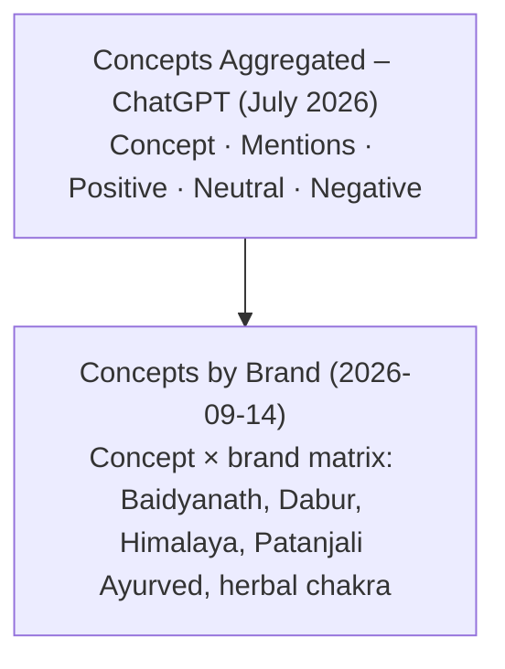
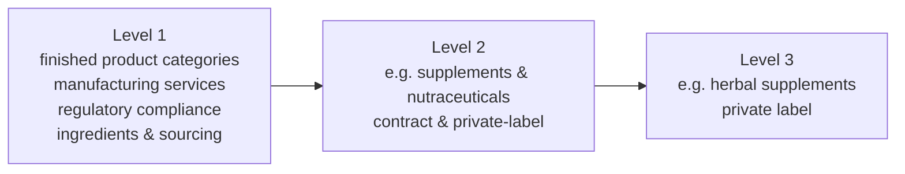
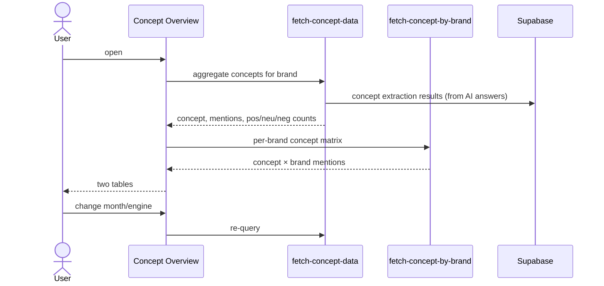
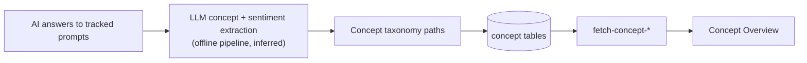

# Analytics → Concept Overview
Route: `/analytics/concepts`

## Purpose
Shows **which topics ("concepts") AI answers associate with the brand** and the **sentiment** of those mentions, aggregated and per competitor brand.

## Controls
Engine (ChatGPT) · month selector (July 2026) · sentiment legend Positive / Neutral / Negative.

## Layout



## Concept hierarchy
Concept names are **hierarchical paths joined by `__`**, e.g.

```
manufacturing services
└─ manufacturing services__contract & private-label
   ├─ ...__contract manufacturing
   └─ ...__private label
finished product categories
└─ finished product categories__supplements & nutraceuticals
   ├─ ...__herbal supplements
   └─ ...__capsules
regulatory compliance & certifications
└─ ...__gmp
   └─ ...__gmp certification
```



Parents' mention counts roll up their children (5 for "finished product categories" vs 4 for its child).

## Architecture and data flow





## Notes
- Two different dates: aggregated view is **July 2026** (monthly), per-brand view is a **2026-09-14** snapshot. Staleness vs. today is the same reporting-lag issue noted in [../09-observations-and-gaps.md](../09-observations-and-gaps.md).
- Use: pick concepts competitors own but the brand lacks, then target them in blogs, FAQs and schema.
- Extraction pipeline is not visible in the browser, so the diagram above is an inference from the data shape.
