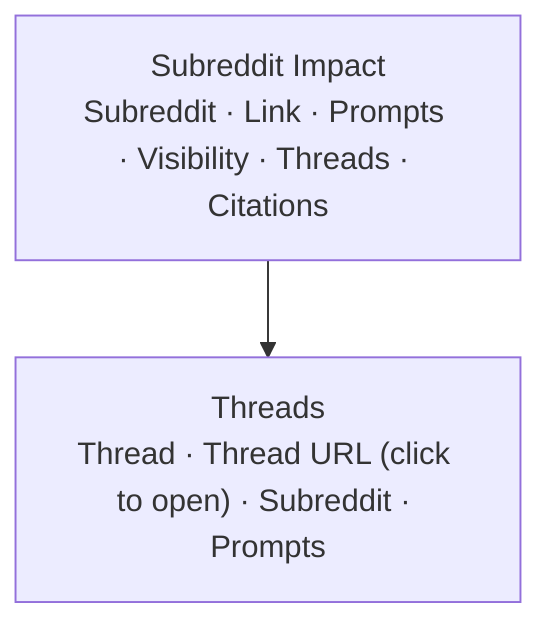
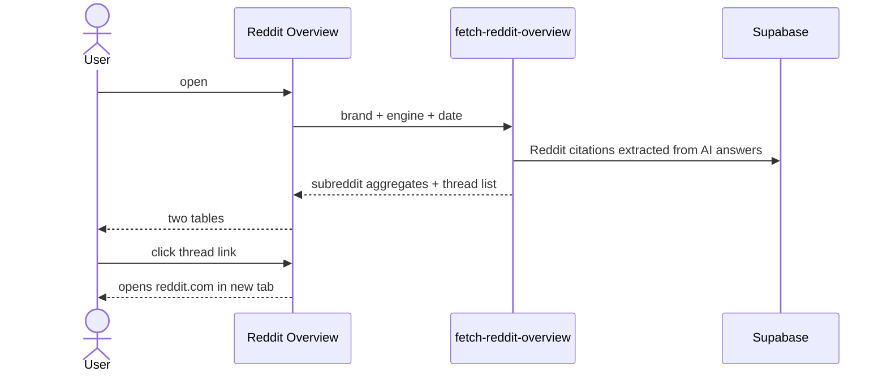
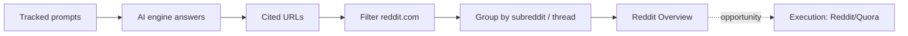

# Analytics → Reddit Overview
Route: `/analytics/reddit-overview` · Subtitle: "Subreddit impact and trending Reddit threads for your brand"

## Purpose
Reddit threads and subreddits that AI engines draw on for the tracked prompts, so the team knows where to participate.

## Controls
Engine (ChatGPT) · date/snapshot selector (2026-09-21).

## Layout

Sample rows: `r/ayurvedabeauty` (1 prompt, 50% visibility, 1 thread, 1 citation) and `r/u_ayurvedic1223`.

## Architecture and data flow

## Definitions
- **Prompts**: number of tracked prompts whose answers cited that subreddit.
- **Visibility**: share of those prompts where the brand was also mentioned (50% = 1 of 2).
- **Threads / Citations**: distinct threads and total times they were cited.

## Notes
- The listed threads are old (2022-era IDs) and not about the brand's category specifically, so this feeds target selection, not brand mentions.
- Links to the Execution → Reddit/Quora page (Question, Answer, Live Link) where answers are written.
