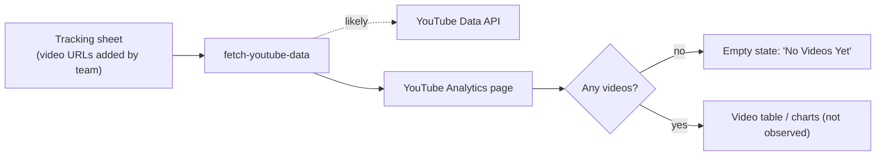
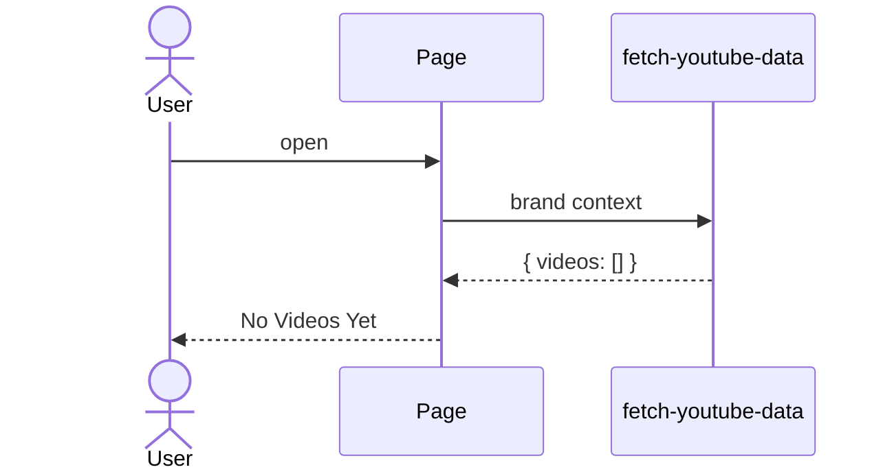
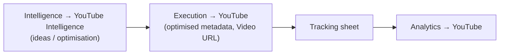

# Analytics → YouTube Analytics
Route: `/analytics/youtube`

## Purpose
Performance of YouTube videos produced for the brand (views, engagement), tracked from a team-maintained **tracking sheet**.

## Current state
Empty: **"No Videos Yet. YouTube video data will appear here once videos are added to the tracking sheet."** The page only showed this empty state, so the populated layout (charts, columns) was not observed.

## Architecture and data flow

## Where the videos come from
Execution → YouTube (`execution_youtube_records`) holds optimised title, description, tags, file and thumbnail names, first comment, playlist and **Video URL**. Once a Video URL is added to the tracking sheet it should appear here. This link between the two pages is an inference.

## Related
`/admin/youtube-overview` exists (staff view, not tested).
