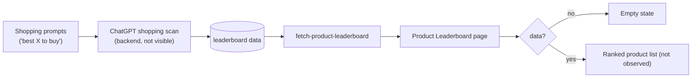
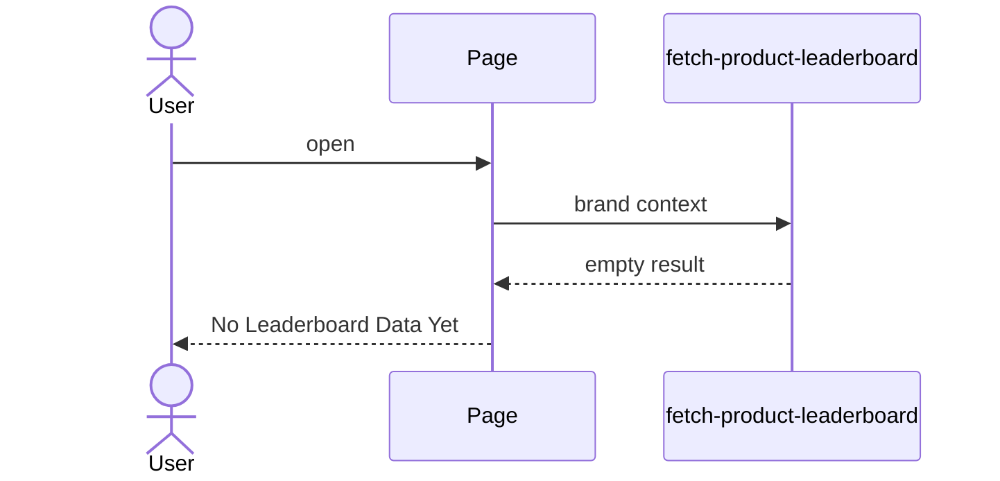

# Analytics → Product Leaderboard
Route: `/analytics/product-leaderboard` · Title on page: **ChatGPT Shopping Leaderboard**

## Purpose
Ranks the brand's products in **ChatGPT shopping-style answers** against other products, for e-commerce brands.

## Current state
Empty: **"No Leaderboard Data Yet. Product leaderboard data will appear here once ranking data is available."** Populated layout not observed. For a manufacturer like Herbal Chakra this module likely isn't applicable.

## Architecture and data flow

## Notes
- A single call with no visible parameters, so brand is resolved server-side from the session or brand selector.
- The data is "ranking data", meaning it is produced by a scan process rather than entered by hand (unlike YouTube and Local Listings, which mention a tracking sheet).
