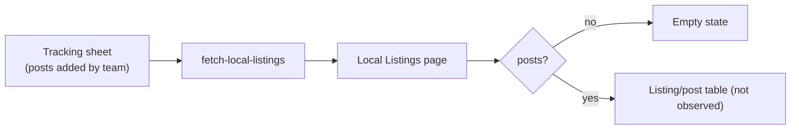
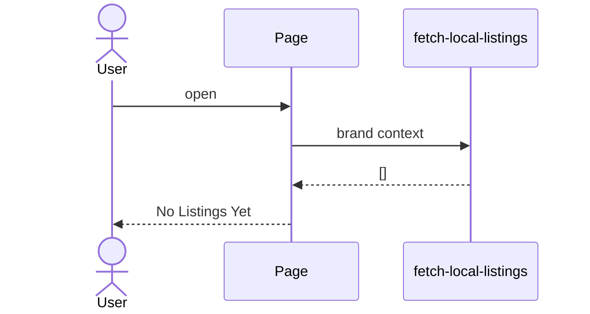

# Analytics → Local Listings
Route: `/analytics/local-listings`

## Purpose
Tracks **local business listing posts** (for example Google Business Profile posts and listings) done for the brand, from a team-maintained **tracking sheet**.

## Current state
Empty: **"No Listings Yet. Local listing data will appear here once posts are added to the tracking sheet."** Populated layout not observed.

## Architecture and data flow

## Notes
- Same pattern as YouTube Analytics: data is pushed in by staff, not collected automatically.
- Related execution surfaces: Directories, Classified and Reviews on Online Communities ([../05-execution-workflow.md](../05-execution-workflow.md)).
- Whether the sheet is a Google Sheet is inferred from the wording "tracking sheet"; the page did not show the source.
