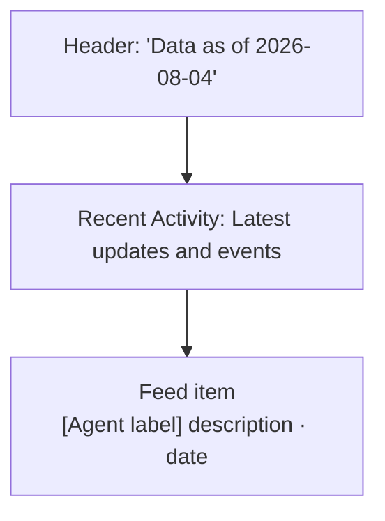
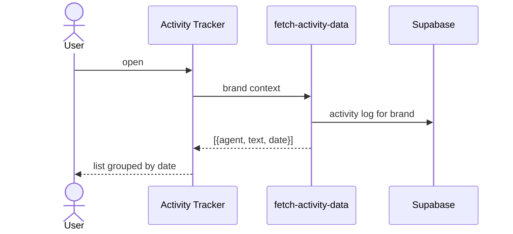
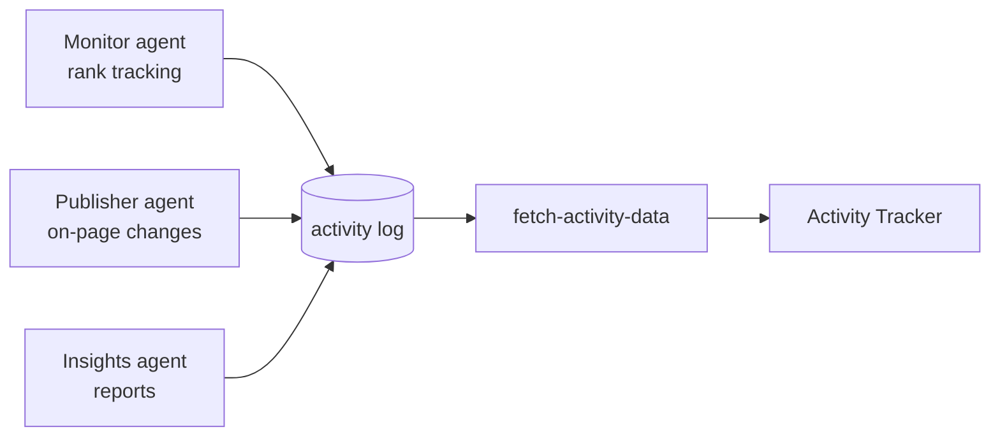

# Analytics → Activity Tracker
Route: `/analytics/activity`

## Purpose
A reverse-chronological feed of **work the DareAISearch team did** for the brand, so the client can see what is happening without opening each Execution page.

## Layout

## Feed content (observed)
Each item is prefixed by a team/agent label. Observed labels and activities:

| Label | Typical activity |
|---|---|
| **Insights** | Validated and finalised monthly performance report; published weekly performance and visibility analysis |
| **Publisher** | Internal linking and image optimisation; META tag and H1 optimisation |
| **Monitor** | Tracked AI prompt rankings across generative platforms; tracked weekly keyword ranking movements |

Items repeat on a cadence (prompt tracking on weekly rhythm, keyword tracking weekly, reports monthly), which suggests auto-generated or templated entries.

## Architecture and data flow

## Issues worth checking
- **Possible cross-brand leak:** the newest items say "validated and finalized the **Escon Gensets** SEO monthly performance report" while the selected brand is Herbal Chakra. Either the feed is not filtered by brand, or the text is mis-templated. Worth a check since it could expose another client's name.
- **Stale:** "Data as of 2026-08-04", about three months before the crawl date.
- Whether the "agents" are automated or human roles is not stated on the page.
