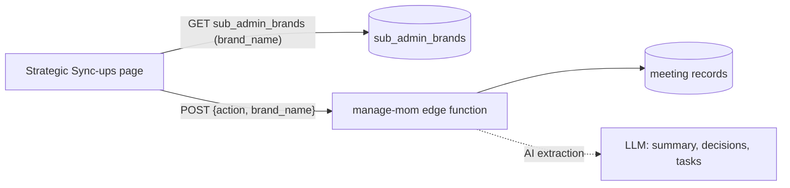
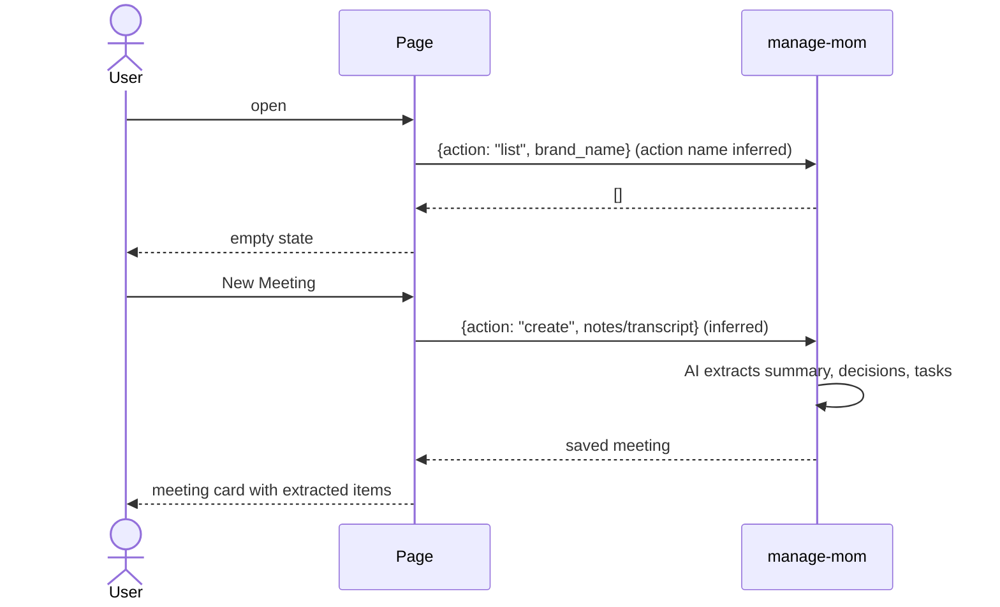
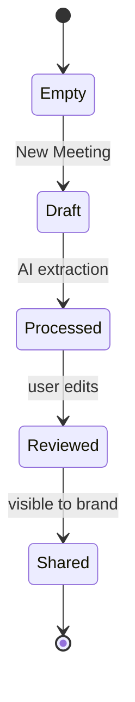

# Analytics → Strategic Sync-ups
Route: `/analytics/brand-mom` · Subtitle: "AI-powered Minutes of Meeting. Extract tasks, decisions & summaries automatically"

## Purpose
Meeting notes (Minutes of Meeting, "MoM") for the brand, where AI turns a transcript or notes into **summary, decisions and tasks**.

## Current state
"No meetings yet. Create your first AI-powered meeting notes to get started." with a **New Meeting** button. The New Meeting form and a populated list were not opened (write action, so not exercised).

## Architecture and data flow

## Meeting lifecycle (inferred)

## Notes
- `sub_admin_brands` is read here, so sub-admins likely see meetings across the brands they manage.
- A separate staff page `/admin/internal-mom` exists in the router for internal meetings.
- Action names (`list`, `create`) and states above are inferred, since only the page-load call `manage-mom {action, brand_name}` was captured.
