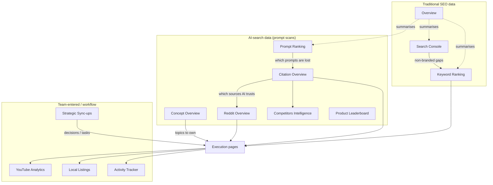

# Analytics: Page-wise Flowcharts & Architecture

One file per Analytics page. Each has purpose, controls, layout diagram, data-flow/architecture diagram, sequence diagram and notes. Source: live crawl of the Herbal Chakra client account (2026-11-12). Statements marked *inferred* are not directly visible in the browser.

| # | Page | Route | Data source in one line |
|---|---|---|---|
| 01 | [Overview](01-overview.md) | `/analytics/overview` | GA4 + GSC + weekly prompt/keyword grids |
| 02 | [Search Console](02-search-console.md) | `/analytics/console-insights` | Google Search Console + branded classifier |
| 03 | [Competitors Intelligence](03-competitors-intelligence.md) | `/analytics/competitors` | AI mentions + Semrush + share-of-voice RPC |
| 04 | [Prompt Ranking](04-prompt-ranking.md) | `/analytics/prompt-ranking` | `weekly_prompt_ranking` + visibility function |
| 05 | [Keyword Ranking](05-keyword-ranking.md) | `/analytics/keyword-ranking` | weekly keyword rank snapshots |
| 06 | [Citation Overview](06-citation-overview.md) | `/analytics/citations` | AI-cited sources per prompt |
| 07 | [Concept Overview](07-concept-overview.md) | `/analytics/concepts` | concept + sentiment extraction from AI answers |
| 08 | [Reddit Overview](08-reddit-overview.md) | `/analytics/reddit-overview` | Reddit URLs cited in AI answers |
| 09 | [YouTube Analytics](09-youtube-analytics.md) | `/analytics/youtube` | team tracking sheet (empty) |
| 10 | [Product Leaderboard](10-product-leaderboard.md) | `/analytics/product-leaderboard` | ChatGPT shopping scan (empty) |
| 11 | [Local Listings](11-local-listings.md) | `/analytics/local-listings` | team tracking sheet (empty) |
| 12 | [Activity Tracker](12-activity-tracker.md) | `/analytics/activity` | activity log |
| 13 | [Strategic Sync-ups](13-strategic-sync-ups.md) | `/analytics/brand-mom` | `manage-mom` (AI meeting notes, empty) |

## How the pages relate

## Shared building blocks (all pages)
- **Brand scoping** from the header brand switcher; most calls accept `brandOverride` for staff.
- **RECOMMENDED ACTIONS (BETA)** on Competitors, Prompt Ranking, Keyword Ranking and Citation Overview come from `generate-page-insights {page, brand, source, signals}`, which returns a category (VISIBILITY, RISK, GROWTH, COMPETITION), a priority (HIGH, MEDIUM), a finding and a next step.
- **Engine toggles** (ChatGPT / Gemini) re-query the same function with a different engine.
- **Empty states** show a plain message when no data exists; four pages were empty for the test brand.

See also: [../04-analytics-data-flow.md](../04-analytics-data-flow.md) for the cross-page map and [../08-page-catalog.md](../08-page-catalog.md) for raw per-page captures.
